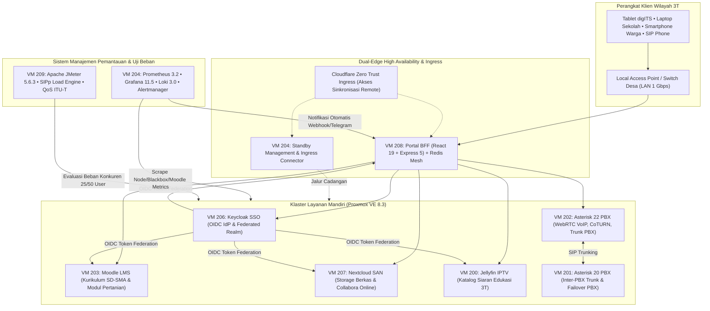

# S4RAS — Solution for Remote Area Services
> **Sistem Layanan Terpadu Edutainment & Infrastruktur Jaringan Mandiri untuk Daerah 3T (Terpencil, Terluar, dan Terdepan) di Indonesia**

Repositori ini adalah **Monorepo** resmi dari **S4RAS (Solution for Remote Area Services)**, sebuah sistem terpadu berbasis pusat data lokal mandiri (*standalone edge server*) yang dirancang khusus untuk mengatasi kesenjangan infrastruktur teknologi informasi dan komunikasi (TIK) serta keterbatasan akses internet broadband di wilayah 3T.

S4RAS diimplementasikan di atas server fisik **Dell PowerEdge R630** dengan virtualisasi **Proxmox VE 8.3** (dikembangkan dan diuji di Laboratorium Jaringan Telekomunikasi / TNL Lab, Departemen Teknik Elektro, Institut Teknologi Sepuluh Nopember).

---

## 🏛️ Layanan Inti S4RAS (Edutainment & Komunikasi Wilayah 3T)

1. **LMS — S4RAS Classroom (`lms-saras`)**
   Platform pembelajaran digital berbasis Moodle 4.5.2 dan Gotenberg API. Menyediakan bahan ajar digital kurikulum siswa **SD, SMP, dan SMA**, serta modul pelatihan praktis masyarakat pedesaan (**pertanian, peternakan, dan industri kecil**) yang dapat diakses secara *offline* melalui jaringan lokal.

2. **VoIP — Telekomunikasi Lokal (`voip-saras`)**
   Layanan komunikasi suara, video, dan pesan instan berbasis IP menggunakan Asterisk 22 PBX, PJSIP dual-trunking, dan WebRTC browser softphone dengan CoTURN STUN/TURN traversal. Memungkinkan komunikasi berbiaya rendah antar-warga dan fasilitas umum tanpa bergantung pada sinyal seluler operator.

3. **IPTV — Media Edutainment (`iptv-saras`)**
   Distribusi siaran televisi dan video pembelajaran edukatif serta hiburan (*edutainment*) masyarakat lokal berbasis Jellyfin 10.10 dan Dispatcharr melalui jaringan lokal (LAN/WLAN) dengan *rebuffering ratio* 0%.

4. **SAN — Penyimpanan Awan Lokal (`san-saras`)**
   Penyimpanan berkas terpusat dan pencadangan data lokal berbasis Nextcloud Hub (v31) dan MariaDB 11.7 dengan Collabora CODE untuk kolaborasi dokumen digital sekolah dan desa.

5. **SSO & Portal Terpadu (`sso-saras` & `portal-saras`)**
   Gerbang akses satu pintu (*Single Sign-On*) berbasis Keycloak 26.1 (OpenID Connect & PKCE) dan Portal BFF (React 19 + Express 5). Dapat diakses lancar melalui jaringan lokal, Access Point desa, maupun tablet pembelajaran *digITS*.

6. **Monitoring & Uji Beban Terpadu (`monitor-saras` & `benchmark-saras`)**
   Sistem manajemen pemantauan kinerja klaster menggunakan Prometheus 3.2, Grafana 11.5, Alertmanager, Node Exporter, Blackbox Exporter, dan Moodle Exporter. Mampu mendeteksi saturasi CPU, *Softnet Out of Quota*, dan *jitter* aplikasi secara proaktif, dilengkapi rangkaian uji beban konkurensi (25 & 50 user) menggunakan Apache JMeter, k6, dan SIPp mengacu pada standar QoS/ITU-T.

---

## 🗺️ Peta Arsitektur Ekosistem Standalone Server



---

## 📁 Struktur Direktori Monorepo

```text
s4ras/
├── README.md                          # Dokumentasi master monorepo S4RAS (Solution for Remote Area Services)
├── LICENSE                            # Lisensi resmi open-source (MIT License)
├── SECURITY.md                        # Kebijakan keamanan fail-closed, kriptografi JWT, & pelaporan celah
├── package.json                       # Konfigurasi npm workspaces & scripts monorepo
├── .gitignore                         # Global gitignore untuk seluruh microservices
├── .env.example                       # Template konfigurasi environment fail-closed
├── docs/                              # Dokumentasi sistem terstruktur
│   ├── architecture/                  # Blueprint arsitektur, whitepaper, & spesifikasi
│   │   ├── ARCHITECTURE_WHITEPAPER.md
│   │   ├── ECOSYSTEM_ARCHITECTURE.md
│   │   └── OPEN_SOURCE_ECOSYSTEM_EXTENSIONS.md
│   ├── operations/                    # Panduan operasional, konfigurasi VM, & runbook
│   │   ├── OPERATIONAL_RUNBOOK.md
│   │   ├── VM_ACCESS.md
│   │   ├── PHASE_PLAN.md
│   │   └── PHASE_TRACKER.md
│   └── reports/                       # Laporan evaluasi QoS, benchmark, & chaos test
│       ├── CHAOS_AND_BENCHMARK_REPORT.md
│       ├── COMPREHENSIVE_END_TO_END_TEST_REPORT.md
│       ├── HANDOVER_AND_INTEGRATION_REPORT.md
│       ├── HOLISTIC_REAUDIT_REPORT.md
│       └── INTERNAL_AUDIT_REPORT.md
│
├── portal-saras/                      # [VM 208] Dashboard Portal Terpadu S4RAS (React 19, Express 5)
├── landing-page/                      # Landing page publik profil S4RAS (Vite, Vue 3, GSAP)
├── sso-saras/                         # [VM 206] Identity & Access Management (Keycloak 26.1, PostgreSQL 16)
├── san-saras/                         # [VM 207] Cloud Storage Hub (Nextcloud Hub v31, MariaDB 11.7, Collabora)
├── iptv-saras/                        # [VM 200] Streaming Media & IPTV Edukasi (Jellyfin, Dispatcharr, Caddy)
├── voip-saras/                        # [VM 202/201] Telekomunikasi IP (Asterisk 22, PJSIP, WebRTC, CoTURN)
├── lms-saras/                         # [VM 203] S4RAS Classroom (Moodle 4.5.2, Gotenberg, PostgreSQL 15)
├── monitor-saras/                     # [VM 204] Observabilitas Metrik & Log (Prometheus 3.2, Grafana 11.5, Loki)
├── benchmark-saras/                   # [VM 209] Pengujian Beban & Evaluasi QoS (Apache JMeter, SIPp, k6)
└── scripts/                           # Otomasi cluster (backup, disaster recovery, firewall, watchdog)
```

---

## 🚀 Matriks Layanan & Status Operasional

| Layanan S4RAS | Node VM | Hostname | Peran Utama di Daerah 3T | Stack Runtime | Status |
| :--- | :---: | :--- | :--- | :--- | :---: |
| **Portal S4RAS** | 208 | `s4ras-portal` | Gerbang navigasi tunggal & event mesh | React 19 + Express 5 BFF + Redis 7 | [ONLINE] 200 OK |
| **Keycloak SSO** | 206 | `s4ras-sso` | Otentikasi terpadu sivitas sekolah & warga | Java 21 / Quarkus 26.1 + PostgreSQL 16 | [ONLINE] 200 OK |
| **S4RAS Classroom** | 203 | `s4ras-lms` | Bahan ajar SD-SMA & pelatihan pertanian/IKM | Moodle 4.5.2 + Gotenberg + PostgreSQL 15 | [ONLINE] 200 OK |
| **Nextcloud SAN** | 207 | `s4ras-san` | Penyimpanan dokumen & kolaborasi lokal | Nextcloud Hub v31 + MariaDB 11.7 + CODE | [ONLINE] 200 OK |
| **Asterisk VoIP** | 202 | `s4ras-voip2` | Telepon WebRTC & trunk suara/video desa | Asterisk 22.4.1 + CoTURN Relay + Caddy | [ONLINE] 200 OK |
| **Jellyfin IPTV** | 200 | `s4ras-iptv` | Siaran video edutainment & TV lokal | Jellyfin 10.10 + Dispatcharr + Caddy | [ONLINE] 200 OK |
| **Monitoring** | 204 | `s4ras-monitor` | Pemantauan bottleneck, resource, & alert | Prometheus 3.2 + Grafana 11.5 + Loki 3.0 | [ONLINE] 200 OK |
| **Benchmarking** | 209 | `s4ras-benchmark` | Evaluasi konkurensi (25/50 user) & QoS | Apache JMeter 5.6.3 + SIPp + Report HTTP | [ONLINE] 200 OK |

---

## 💻 Panduan Menjalankan & Pengujian

### Prasyarat
* Node.js >= 22.x LTS & npm >= 10.x
* Git
* Docker & Docker Compose (opsional untuk containerisasi mandiri)

### Perintah Utama
```bash
# Menjalankan antarmuka portal lokal
npm run portal:dev

# Menjalankan seluruh test suite keamanan & komponen
npm run portal:test

# Membangun bundle produksi landing page dan portal
npm run build

# Menjalankan audit linting kode
npm run portal:lint
```

---

## 📚 Indeks Dokumentasi Teknis

### 🏛️ Arsitektur & Spesifikasi Sistem
* [Spesifikasi & Blueprint Arsitektur S4RAS](docs/architecture/ECOSYSTEM_ARCHITECTURE.md)
* [Whitepaper Arsitektur Sistem Server Mandiri](docs/architecture/ARCHITECTURE_WHITEPAPER.md)
* [Spesifikasi Ekstensi Open Source](docs/architecture/OPEN_SOURCE_ECOSYSTEM_EXTENSIONS.md)

### 🛠️ Operasional & Tata Kelola Infrastruktur
* [Buku Panduan Operasional Klaster (Operational Runbook)](docs/operations/OPERATIONAL_RUNBOOK.md)
* [Topologi Jaringan, VM, & Konfigurasi Akses](docs/operations/VM_ACCESS.md)
* [Rencana Fase Pengembangan (Phase Plan)](docs/operations/PHASE_PLAN.md)
* [Pelacak Implementasi Fase (Phase Tracker)](docs/operations/PHASE_TRACKER.md)

### 📊 Laporan Pengujian, Kinerja, & Evaluasi QoS
* [Laporan Chaos Engineering & Pengujian Beban JMeter](docs/reports/CHAOS_AND_BENCHMARK_REPORT.md)
* [Laporan Pengujian Komprehensif End-to-End](docs/reports/COMPREHENSIVE_END_TO_END_TEST_REPORT.md)
* [Laporan Audit Internal & Pengerasan Keamanan](docs/reports/INTERNAL_AUDIT_REPORT.md)
* [Laporan Re-Audit Holistik](docs/reports/HOLISTIC_REAUDIT_REPORT.md)
* [Laporan Integrasi & Serah Terima Sistem](docs/reports/HANDOVER_AND_INTEGRATION_REPORT.md)
