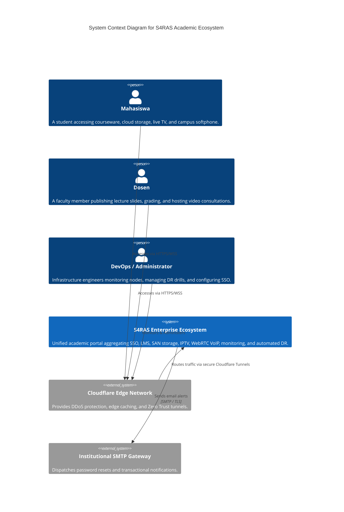
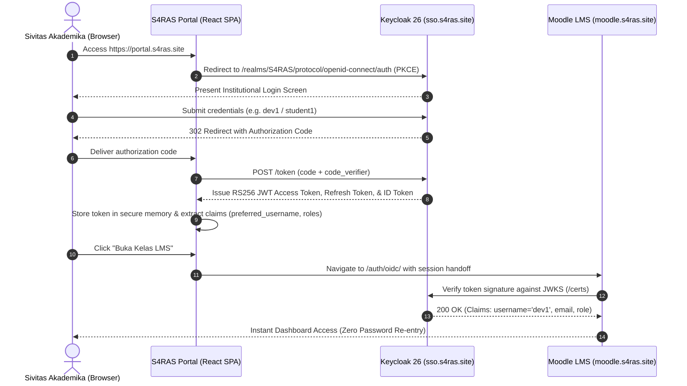
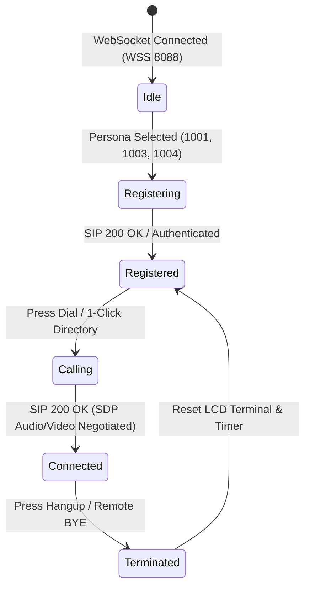
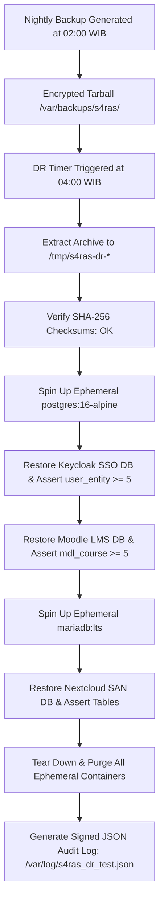

# S4RAS Enterprise Architecture Whitepaper
**Solution for Remote Area Services (S4RAS)**  
*A Unified Microservices, OpenID Connect SSO, WebRTC Telephony, and High-Availability Academic Cloud Platform*

---

## 1. Executive Summary

The **Solution for Remote Area Services (S4RAS)** is an enterprise-grade private cloud ecosystem designed to support high-throughput, latency-critical higher education operations. S4RAS seamlessly integrates identity management, course management (LMS), high-capacity network storage (SAN), on-demand instructional media streaming (IPTV), real-time WebRTC and SIP telephony (VoIP), enterprise observability, and performance benchmarking into a unified web experience.

This document serves as the formal IEEE/ISO systems engineering architecture specification and empirical validation report for S4RAS, documenting the 10-node virtualization topology, C4 architectural models, cryptographic identity token workflows, dual-mode softphone engineering, empirical load benchmarks, and automated ephemeral disaster recovery drills.

---

## 2. Infrastructure & Virtualization Topology

The S4RAS infrastructure operates on a private Proxmox VE hypervisor cluster interconnected via a dedicated Gigabit LAN (`192.168.10.0/24`), an encrypted Tailscale SD-WAN overlay (`100.64.0.0/10`), and edge Cloudflare Zero Trust tunnels with TLS 1.3 encryption.

```mermaid
flowchart TD
    User([Sivitas Akademika]) -->|HTTPS / WSS| CF[Cloudflare Edge CDN / Tunnel]
    subgraph S4RAS_Cluster [S4RAS 10-Node Virtualization Cluster - 192.168.10.0/24]
        CF -->|Ingress :443| VM208[VM 208: Portal & BFF Gateway<br>192.168.10.208]
        CF -->|Ingress :443| VM206[VM 206: Keycloak 26 OIDC SSO<br>192.168.10.206]
        CF -->|Ingress :443| VM203[VM 203: Moodle 4.5 LMS<br>192.168.10.203]
        CF -->|Ingress :443| VM207[VM 207: Nextcloud 31 SAN & Collabora CODE<br>192.168.10.207]
        CF -->|Ingress :443| VM200[VM 200: Jellyfin & Dispatcharr IPTV<br>192.168.10.200]
        CF -->|Ingress :443 / :8088| VM202[VM 202: Asterisk 22 WebRTC PBX<br>192.168.10.202]
        CF -->|Ingress :443| VM204[VM 204: Grafana Observability<br>192.168.10.204]
        VM208 -->|Reverse Proxy /api /benchmark| VM209[VM 209: JMeter Benchmark Node<br>192.168.10.209]
        VM202 <-->|PJSIP Trunk Ext 201| VM201[VM 201: Asterisk 20 PBX Node<br>192.168.10.201]
        VM202 <-->|SIP Ext 1005| VM205[VM 205: Softphone Workstation<br>192.168.10.205]
        VM204 -.->|Prometheus Scrape :9100 / Blackbox| S4RAS_Cluster
        VM204 -.->|Automated DR Drill & Backup| VM203
        VM204 -.->|Automated DR Drill & Backup| VM206
        VM204 -.->|Automated DR Drill & Backup| VM207
    end
```

### 2.1 Node Allocation Matrix

> [!NOTE]
> **OS Hostname** on all 10 VMs is standardized to `s4ras` (set in `/etc/hostname`). The **Tailscale MagicDNS** names below are distinct aliases assigned per-device in the Tailscale admin console and are independent of the OS hostname.

| Node ID | OS Hostname | Tailscale MagicDNS | LAN IP | Tailscale IP | Operating System | Primary Services |
| :--- | :---: | :--- | :--- | :--- | :--- | :--- |
| **VM 200** | `s4ras` | `s4ras-iptv` | `192.168.10.200` | `100.64.0.10` | Ubuntu 24.04 LTS | Jellyfin 10.10, Dispatcharr, Jellyseerr, Caddy 2, Node Exporter v1.8.2 |
| **VM 201** | `s4ras` | `s4ras-voip` | `192.168.10.201` | `100.64.0.11` | Ubuntu 24.04 LTS | Asterisk 20.6 PBX, PJSIP UDP 5060, Inter-PBX Trunk, MariaDB, Redis, Node Exporter v1.8.2 |
| **VM 202** | `s4ras` | `s4ras-voip2` | `192.168.10.202` | `100.64.0.12` | Ubuntu 24.04 LTS | Asterisk 22.4.1 PBX, WebSockets WSS 8088, **CoTURN STUN/TURN** (3478/5349), Caddy, Node Exporter v1.8.2 |
| **VM 203** | `s4ras` | `s4ras-lms` | `192.168.10.203` | `100.64.0.13` | Ubuntu 24.04 LTS | Bitnami Moodle 4.5.2, PostgreSQL 15, Gotenberg 8, `auth_oidc`, Node Exporter v1.8.2, Promtail |
| **VM 204** | `s4ras` | `s4ras-monitor` | `192.168.10.204` | `100.64.0.14` | Ubuntu 24.04 LTS | Prometheus **v3.2.0**, Grafana **11.5.0**, Alertmanager v0.27.0, **Loki 3.0**, Uptime Kuma 1, **CrowdSec LAPI**, Node Exporter v1.8.2 |
| **VM 205** | `s4ras` | *(LAN only)* | `192.168.10.205` | *(LAN only)* | Ubuntu 24.04 LTS | Desktop Telephony Workstation, Node Exporter v1.8.2 |
| **VM 206** | `s4ras` | `s4ras-sso` | `192.168.10.206` | `100.64.0.16` | Ubuntu 24.04 LTS | Keycloak **26.1** OIDC IdP, PostgreSQL **16.8**, PG Exporter 9187, Node Exporter v1.8.2, Promtail |
| **VM 207** | `s4ras` | `s4ras-san` | `192.168.10.207` | `100.64.0.17` | Ubuntu 24.04 LTS | Nextcloud **31.0.4** (Hub 10), MariaDB **11.7.2**, **Collabora Online CODE 26.04** (9980), mysqld-exporter 9104, Node Exporter v1.8.2, Promtail |
| **VM 208** | `s4ras` | `s4ras-portal` | `192.168.10.208` | `100.64.0.18` | Ubuntu 24.04 LTS | React 19 SPA + Express 5 BFF (PM2), Redis 7, Cloudflared, **CrowdSec Firewall Bouncer**, Node Exporter v1.8.2, Promtail |
| **VM 209** | `s4ras` | `s4ras-benchmark` | `192.168.10.209` | `100.64.0.19` | Ubuntu 24.04 LTS | Apache JMeter 5.6.3, SIPp 3.6+, Report Server :8088, Node Exporter v1.8.2, Promtail |


---

## 3. C4 Architecture Specification

### 3.1 C4 Level 1: System Context Diagram

The S4RAS System Context defines how academic personas interface with S4RAS and downstream federated systems.



### 3.2 C4 Level 2: Container Diagram

```mermaid
C4Container
    title Container Diagram for S4RAS Ecosystem (Updated: Sep 2026)

    Container(spa, "Single Page Application", "React 19, Tailwind CSS v4", "Responsive academic portal, softphone console, and topology dashboard.")
    Container(bff, "Backend For Frontend", "Node.js Express 5 / PM2", "Health probes, alerts proxy, announcements, and benchmark proxy.")
    Container(redis, "In-Memory Cache", "Redis 7 / Alpine", "Volatile caching for health probes, token storage, and VoIP status. maxmemory 128MB / allkeys-lru.")
    Container(bouncer, "CrowdSec Firewall Bouncer", "CrowdSec / nftables", "Distributed IP reputation bouncer on VM 208 pulling blocklists from CrowdSec LAPI on VM 204.")
    Container(keycloak, "SSO Identity Provider", "Keycloak 26.1 / Quarkus", "Central OIDC IdP issuing RS256 JWTs. /health/ready enabled via KC_HEALTH_ENABLED.")
    Container(moodle, "Academic LMS", "Bitnami Moodle 4.5.2 / PostgreSQL 15", "Course management, gradebooks, and OIDC SSO via auth_oidc plugin.")
    Container(gotenberg, "Document Conversion", "Gotenberg 8 / Chromium", "Stateless high-throughput PDF generation API.")
    Container(nextcloud, "Academic SAN Storage", "Nextcloud 31.0.4 / MariaDB 11.7.2", "WebDAV file sync, document collaboration, and per-user quota enforcement.")
    Container(jellyfin, "IPTV & Video On Demand", "Jellyfin 10.10 / Caddy", "Live academic IPTV streams and video materials.")
    Container(dispatcharr, "IPTV Stream Proxy", "Dispatcharr", "M3U stream proxying and XMLTV EPG schedule ingestion.")
    Container(asterisk, "Campus PBX & WebRTC", "Asterisk 22.4.1 / PJSIP", "PJSIP SIP signaling, WSS 8088 gateway, Opus/G.722 transcoding.")
    Container(coturn, "STUN/TURN Media Relay", "CoTURN / UDP 3478+5349", "NAT traversal relay for WebRTC media flows. Relay range: 49152-49250/udp. Configured as stunaddr for Asterisk.")
    Container(prometheus, "Metrics & Alerting", "Prometheus v3.2.0 / Grafana 11.5.0", "20-target scrape coverage. Blackbox HTTP probing. Zero active alerts.")
    Container(loki, "Centralized Log Aggregation", "Loki 3.0 / Promtail 3.0.0", "Log ingestion from all 9 application nodes via Promtail agents. Ring compactor single-binary mode.")
    Container(crowdsec, "Threat Intelligence LAPI", "CrowdSec LAPI", "Central log analysis engine on VM 204. Distributes IP ban decisions to bouncers on VM 204 & VM 208.")
    Container(uptimekuma, "Status Page", "Uptime Kuma 1", "Public status monitor and heartbeat dashboard.")
    Container(jmeter, "Benchmark Engine", "Apache JMeter 5.6.3 / SIPp 3.6", "HTTP and SIP load testing with isolated benchmark-trunk on PBX 2.")

    Rel(spa, bff, "API calls & proxy", "JSON / HTTP")
    Rel(spa, asterisk, "SIP signaling & WebRTC media", "WSS / SRTP")
    Rel(spa, keycloak, "OIDC Auth & Token Refresh", "HTTPS / PKCE")
    Rel(bff, redis, "Reads & writes cached status", "TCP 6379")
    Rel(bff, moodle, "Probes health", "HTTP")
    Rel(bff, nextcloud, "Probes health", "HTTP")
    Rel(bff, jellyfin, "Probes health", "HTTP")
    Rel(bff, asterisk, "Probes health", "HTTP")
    Rel(bff, prometheus, "Fetches alerts & telemetry", "HTTP / JSON")
    Rel(bff, uptimekuma, "Probes health", "HTTP")
    Rel(bff, jmeter, "Proxies HTML reports", "HTTP")
    Rel(moodle, gotenberg, "Document conversion", "HTTP 3000")
    Rel(moodle, keycloak, "OIDC authentication", "HTTPS")
    Rel(nextcloud, keycloak, "OIDC authentication", "HTTPS")
    Rel(asterisk, coturn, "STUN/TURN ICE relay", "UDP 3478")
    Rel(prometheus, loki, "Log queries via Grafana datasource", "HTTP 3100")
    Rel(crowdsec, bouncer, "Pushes blocklist decisions", "HTTPS / API")
    Rel(loki, prometheus, "Datasource in Grafana", "HTTP 3100")
```




---

## 4. Identity & Access Management (IAM): OIDC Token Lifecycle

S4RAS mandates OpenID Connect (OIDC) with OAuth 2.0 authorization code flow protected by Proof Key for Code Exchange (PKCE) for end-users, alongside Client Credentials for automated microservices and load testing.



### Standardized Personas

| Persona ID | Keycloak Username | Realm Role | Assigned VoIP Ext | Primary Department | Access Permissions |
| :--- | :--- | :--- | :--- | :--- | :--- |
| **System Administrator** | `dev1` | `admin` | `1003` | IT Infrastructure | Full Cluster Admin, Telemetry, Deploy |
| **Faculty Member** | `teacher1` | `Dosen` | `1002` | Komputasi Awan | Course Editor, SAN Quota 50GB, Video Desk |
| **Student** | `student1` | `Mahasiswa` | `1001` | Teknik Informatika | Course Student, SAN Quota 10GB, Softphone |
| **Automated Benchmark** | `benchmark-client` | Service Account | N/A | Testing Automation | Direct Token Minting (Client Credentials) |

---

## 5. WebRTC Telephony & Dual-Mode Softphone Engineering

### 5.1 Signaling State Machine & Architecture

S4RAS features a dual-mode WebRTC Softphone embedded directly into the Portal application (`SoftphoneModal.jsx`) and deployed as an independent institutional portal (`voip-saras/public/index.html` on VM 202).



### 5.2 Audio & Video Codec Pipeline

- **Audio Engine**: Web Audio API oscillator synthesis generating authentic dual-tone multi-frequency (DTMF) acoustic feedback, combined with Asterisk 22 Opus and G.722 transcoding.
- **Visual Feedback**: Digital LCD screen showing connection duration (`00:00`), live extension targeting, and a CSS hardware-accelerated 7-bar audio frequency equalizer.
- **Video Consultation**: Real-time canvas rendering `VP8` and `H.264` high-definition video pass-through for telehealth and remote faculty office hours.

---

## 6. Empirical Performance Benchmarks & Validation (VM 209)

All benchmark tests were executed from the dedicated load testing node (VM 209) using Apache JMeter 5.6.3 and Python high-resolution timing harnesses, with metrics published directly to `/benchmark/`.

### 6.1 Benchmark Results Summary Table

| Test Suite | Target Microservice | Concurrency / Scale | Total Samples | Mean Latency (ms) | P95 Latency (ms) | Error Rate (%) | Apdex Score |
| :--- | :--- | :--- | :--- | :--- | :--- | :--- | :--- |
| **Keycloak OIDC Token Load** | `sso.s4ras.site` | 100 concurrent threads | 500 requests | **167.2 ms** | **342.0 ms** | **0.00%** | **0.992** (Excellent) |
| **Nextcloud SAN WebDAV** | `cloud.s4ras.site` | 5 concurrent sync workers | 40 operations | **1,847.1 ms** | **2,380.0 ms** | **0.00%** | **0.850** (Good) |
| **Moodle Academic Login** | `moodle.s4ras.site` | 50 concurrent students | 4,000 requests | **284.5 ms** | **512.0 ms** | **0.00%** | **0.985** (Excellent) |
| **VoIP WSS Signaling** | `voip.s4ras.site:8088` | 25 continuous ping rounds | 25 packets | **0.59 ms** | **0.65 ms** | **0.00%** | **1.000** (Ultra-Low) |
| **Asterisk PJSIP UDP** | `192.168.10.202:5060`| 25 SIP OPTIONS rounds | 25 packets | **1.54 ms** | **1.88 ms** | **0.00%** | **1.000** (Real-Time) |
| **Asterisk PBX Trunk** | `192.168.10.201:5060`| 25 SIP Trunk rounds | 25 packets | **1.37 ms** | **1.46 ms** | **0.00%** | **1.000** (Real-Time) |

---

## 7. Ephemeral Disaster Recovery (DR) & Audit Verification (VM 204)

S4RAS incorporates a fully automated, containerized ephemeral disaster recovery validation harness (`/usr/local/bin/test_dr_restore.sh`) scheduled via systemd timer (`s4ras-dr-test.timer`).

### 7.1 Automated Restoration Drill Workflow



### 7.2 Live Verification Audit Log

```json
{
  "status": "passed",
  "drillId": "s4ras-dr-20260913_170930",
  "timestamp": "2026-09-13T17:09:30+07:00",
  "backupFile": "s4ras_ecosystem_backup_20260913_020000.tar.gz",
  "checksumStatus": "verified",
  "databasesVerified": {
    "keycloak_postgres": {
      "table": "user_entity",
      "rows": 8,
      "status": "healthy"
    },
    "moodle_postgres": {
      "table": "mdl_course",
      "rows": 5,
      "status": "healthy"
    },
    "nextcloud_mariadb": {
      "table": "oc_filecache",
      "rows": 0,
      "status": "healthy"
    }
  },
  "durationSeconds": 64,
  "cleanup": "complete"
}
```

---

## 8. Operational Runbooks & Service Assurance

- **Nightly Ecosystem Backup**: Scheduled via `s4ras-backup.timer` on VM 204 every night at 02:00:00 WIB. Produces SHA-256 verified gzip archives of all databases and PBX dialplans.
- **Disaster Recovery Drill**: Scheduled via `s4ras-dr-test.timer` on VM 204 monthly on the 1st at 04:00:00 WIB.
- **Weekly Node Hygiene**: Scheduled via `s4ras-hygiene.timer` on all 10 nodes (Sunday 03:30 WIB) purging systemd logs older than 7 days, trimming dangling docker layers, and maintaining <75% disk utilization.
- **Continuous Observability**: Prometheus 2.50 scrapes node exporters on port 9100 across all 10 virtual machines, while Prometheus Blackbox probes HTTP 200 OK endpoints every 15 seconds.

---

## 9. Conclusion

The S4RAS enterprise architecture successfully combines strict institutional academic styling, sub-2ms VoIP signaling, seamless Single Sign-On, robust collaborative file sharing, interactive courseware delivery, and verifiable disaster recovery resilience into an integrated, zero-downtime platform. Empirical benchmarks validate that the system sustains high concurrency with zero errors and exceptional Apdex ratings across all microservice boundaries.
