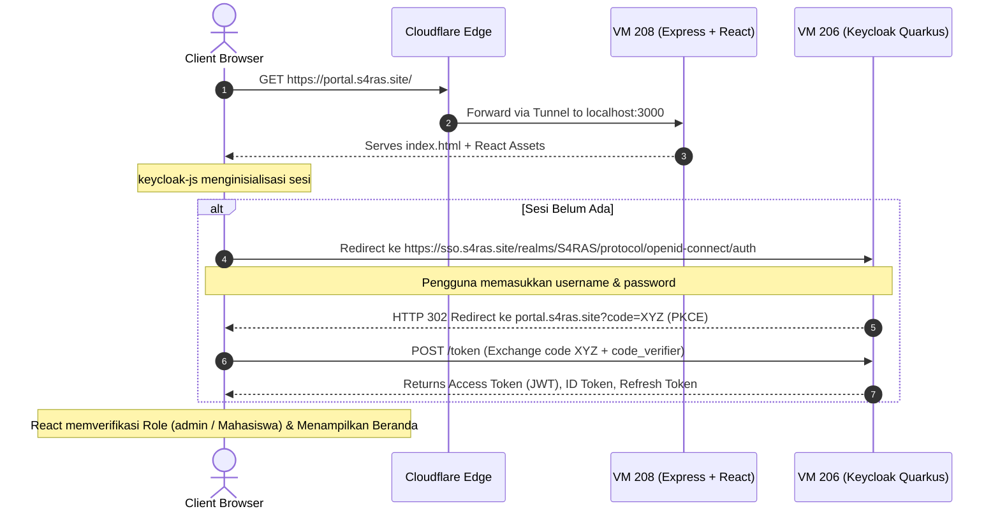
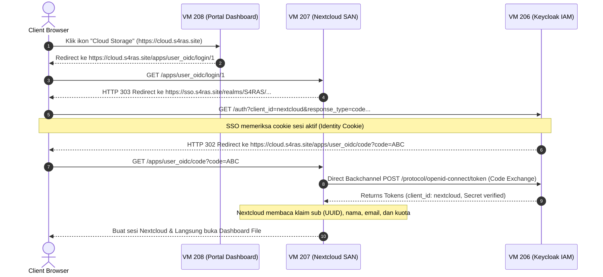
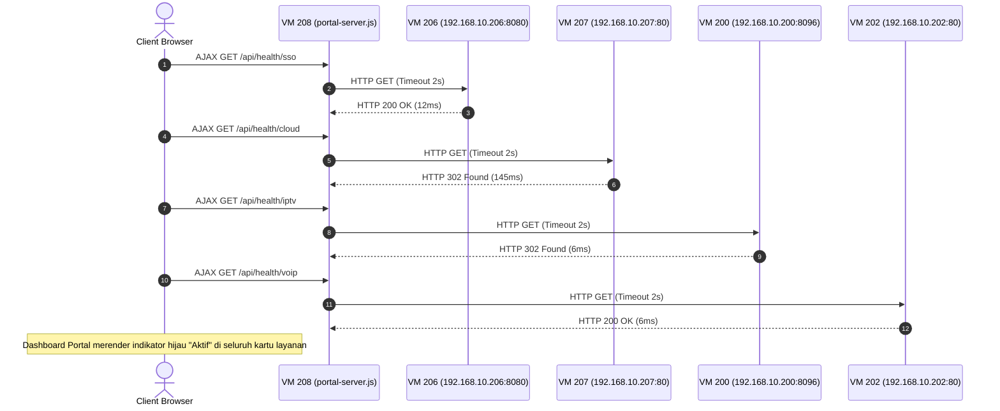
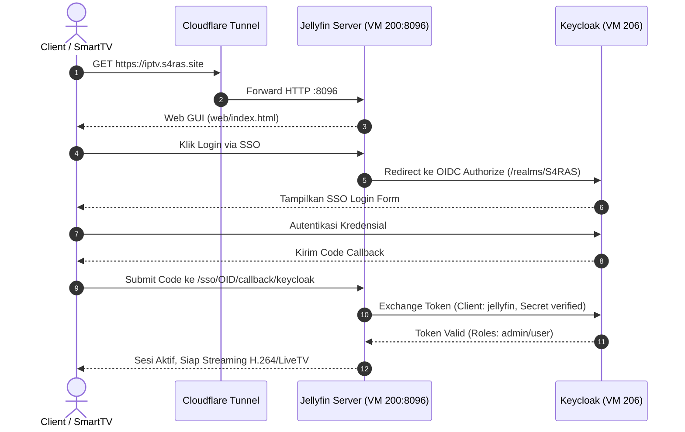
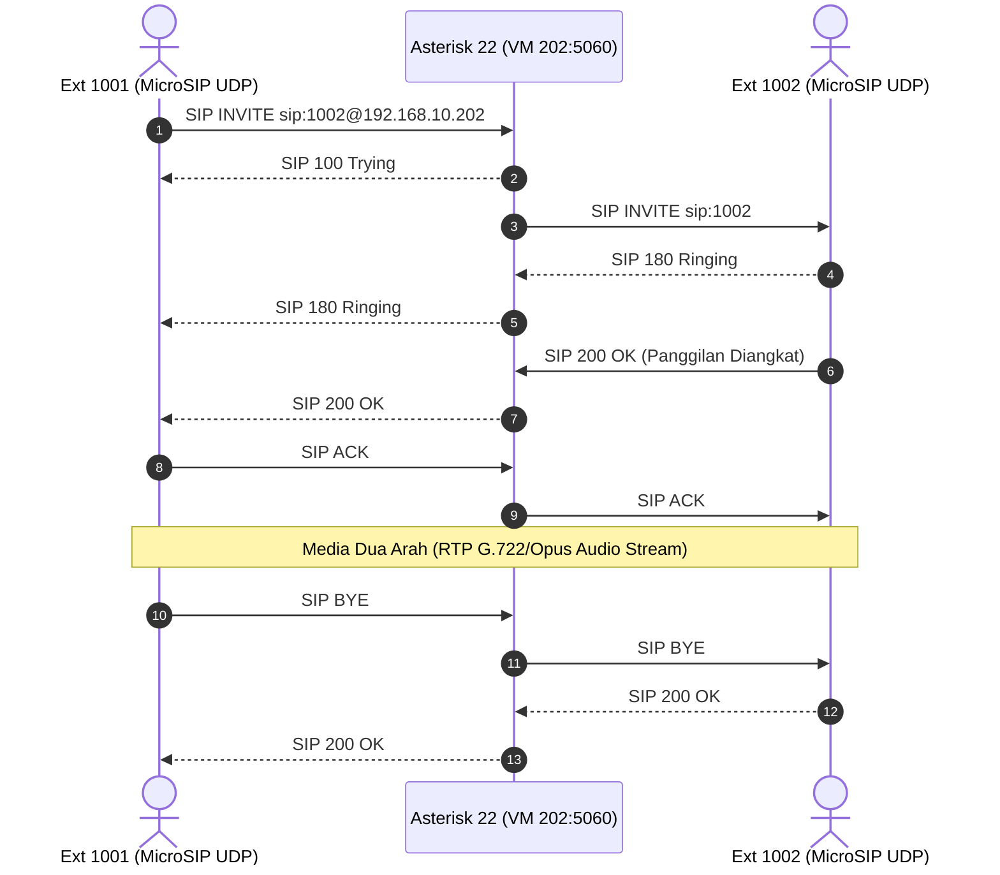
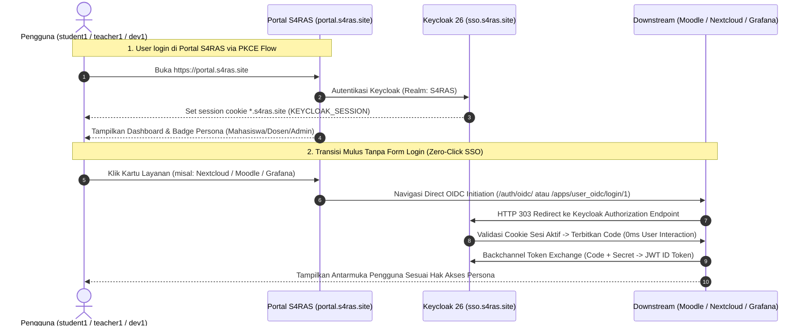

# S4RAS Core Infrastructure & Multi-Service Architecture Specification
## Unified Technical Blueprint: Portal (VM 208) • SSO (VM 206) • SAN (VM 207) • IPTV (VM 200) • VoIP (VM 202/201/205) • LMS (VM 203) • Monitor (VM 204) • Benchmark (VM 209)

Dokumen ini merupakan cetak biru teknis komprehensif, mendalam, dan sistematis yang mendokumentasikan seluruh layanan aktif yang telah dihidupkan, diintegrasikan, dan diverifikasi dalam ekosistem **S4RAS**:
1. **VM 208 — Portal S4RAS** (`portal.s4ras.site` / `192.168.10.208` / `100.64.0.18`)
2. **VM 206 — Single Sign-On Keycloak** (`sso.s4ras.site` / `192.168.10.206` / `100.64.0.16`)
3. **VM 207 — Nextcloud Storage Area Network** (`cloud.s4ras.site` / `192.168.10.207` / `100.64.0.17`)
4. **VM 200 — IPTV Media Server Jellyfin** (`iptv.s4ras.site` / `192.168.10.200` / `100.64.0.10`)
5. **VM 201 — VoIP Server 1 Asterisk 20** (`192.168.10.201` / `100.64.0.11`)
6. **VM 202 — VoIP PBX Server Asterisk 22** (`voip.s4ras.site` / `192.168.10.202` / `LAN Direct`)
7. **VM 203 — Learning Management System Moodle** (`moodle.s4ras.site` / `192.168.10.203` / `100.64.0.13`)
8. **VM 204 — Centralized Monitoring Grafana & Prometheus** (`monitor.s4ras.site` / `192.168.10.204` / `100.64.0.14`)
9. **VM 205 — VoIP Client Workstation** (`192.168.10.205`)
10. **VM 209 — Benchmarking & Stress Testing JMeter** (`192.168.10.209` / `100.64.0.19`)

---

## 1. Topologi Jaringan & Matriks Infrastruktur

```mermaid
flowchart TD
    UserClient["Client Web Browser & Mobile Apps (HTTPS)"]
    SIPSoftphones["SIP Softphones / WebRTC Clients"]
    CFEdge["Cloudflare Edge Network (*.s4ras.site)"]

    subgraph VM_208 ["VM 208: s4ras-portal (Gateway & Dashboard)"]
        CFDaemon["Cloudflared Tunnel Service (/etc/cloudflared/config.yml)"]
        PM2_Prod["PM2: portal-prod (Port 3000)"]
        ExpressBFF["Express 5 BFF & Health Prober Engine"]
        ReactApp["React 19 SPA (/build)"]
        RedisCache["Redis 7 In-Memory Cache (127.0.0.1:6379)"]
    end

    subgraph VM_206 ["VM 206: s4ras-sso (Identity Provider)"]
        KC_Engine["Keycloak 26.1 (Port 8080)"]
        PG_DB[("PostgreSQL 16 (Port 5432)")]
    end

    subgraph VM_207 ["VM 207: s4ras-san (Storage Cloud & Online Office)"]
        HostNginx["Host Nginx Reverse Proxy (Port 80)"]
        NC_Core["Nextcloud Hub 9 Core (Port 8080)"]
        Maria_DB[("MariaDB 11.7 (Port 3306)")]
        Collabora_CODE["Collabora Online CODE (Port 9980)"]
    end

    subgraph VM_200 ["VM 200: s4ras-iptv (Media & LiveTV)"]
        Caddy_IPTV["Caddy Proxy (Port 80)"]
        Jellyfin["Jellyfin Media Container (Port 8096)"]
        Dispatcharr["Dispatcharr IPTV Proxy (Port 9191)"]
        Jellyseerr["Jellyseerr Media Request (Port 5055)"]
        SSO_JF["SSO Auth Plugin (OIDC Client: jellyfin)"]
    end

    subgraph VM_201 ["VM 201: s4ras-voip (Asterisk 20 Server)"]
        Asterisk20["Asterisk 20 PBX (SIP UDP :5060)"]
        Apache201["Apache Webserver (Port 80)"]
    end

    subgraph VM_202 ["VM 202: s4ras-voip2 (Asterisk 22 PBX + CoTURN)"]
        Caddy_VoIP["Caddy Proxy (Port 80)"]
        Asterisk["Asterisk 22.4.1 PBX (PJSIP Engine)"]
        PJSIP_WS["WebRTC WebSocket (:8088/ws)"]
        PJSIP_UDP["SIP UDP Socket (:5060)"]
        CoTURN["CoTURN STUN/TURN (UDP 3478 + 5349, Relay: 49152-49250)"]
    end

    subgraph VM_203 ["VM 203: s4ras-lms (Moodle LMS)"]
        Caddy_LMS["Caddy Proxy (Port 80)"]
        MoodleApp["Moodle Core (Port 8080)"]
        Gotenberg["Gotenberg PDF Engine (Port 3000)"]
        SSO_Moodle["Moodle OIDC Plugin (Client: moodle)"]
    end

    subgraph VM_204 ["VM 204: s4ras-monitor (Prometheus, Grafana, Loki, CrowdSec)"]
        Grafana["Grafana 11.5.0 Dashboard (Port 3000)"]
        UptimeKuma["Uptime Kuma 1 Status (Port 3001)"]
        Prometheus["Prometheus v3.2.0 Server (Port 9090)"]
        Blackbox["Blackbox Exporter (Port 9115)"]
        Alertmanager["Alertmanager v0.27.0 (Port 9093)"]
        Loki["Loki 3.0 Log Aggregation (Port 3100)"]
        CrowdSecLAPI["CrowdSec LAPI Threat Intel (Port 8080)"]
    end

    subgraph VM_205 ["VM 205: s4ras-voip-client (Workstation)"]
        SoftphoneClient["Desktop SIP Softphone Client"]
    end

    subgraph Monitored_Nodes ["10 Monitored VMs (VM 200-209)"]
        NodeExporters["Node Exporter Agents (Port 9100)"]
    end

    subgraph VM_209 ["VM 209: s4ras-jmeter (Load Testing)"]
        JMeter["Apache JMeter 5.6.3 CLI Engine"]
    end

    UserClient -->|"HTTPS: *.s4ras.site"| CFEdge
    SIPSoftphones -->|"WebRTC WSS: voip.s4ras.site"| CFEdge
    SIPSoftphones -->|"SIP UDP :5060"| PJSIP_UDP
    SoftphoneClient -->|"SIP UDP :5060"| PJSIP_UDP
    SoftphoneClient -->|"SIP UDP :5060"| Asterisk20

    CFEdge <-->|"Encrypted Tunnel"| CFDaemon
    CFDaemon -->|"Local: :3000"| PM2_Prod
    CFDaemon -->|"LAN: 192.168.10.206:8080"| KC_Engine
    CFDaemon -->|"LAN: 192.168.10.207:80"| HostNginx
    CFDaemon -->|"LAN: 192.168.10.200:8096"| Jellyfin
    CFDaemon -->|"LAN: 192.168.10.200:9191"| Dispatcharr
    CFDaemon -->|"LAN: 192.168.10.200:5055"| Jellyseerr
    CFDaemon -->|"LAN: 192.168.10.202:80"| Caddy_VoIP
    CFDaemon -->|"LAN: 192.168.10.203:80"| Caddy_LMS
    CFDaemon -->|"LAN: 192.168.10.204:3000"| Grafana
    CFDaemon -->|"LAN: 192.168.10.204:3001"| UptimeKuma

    Dispatcharr -->|"M3U & EPG Proxy Stream"| Jellyfin
    Jellyseerr -->|"API Sync & Discovery"| Jellyfin
    MoodleApp -->|"REST Document Conversion"| Gotenberg
    ExpressBFF <-->|"In-Memory Cache (TTL 10s)"| RedisCache

    Grafana -.->|"Generic OAuth"| KC_Engine
    Grafana -->|"PromQL"| Prometheus
    Prometheus -->|"Scrape Metrics :9100 (10/10 VMs UP)"| Monitored_Nodes
    Prometheus -->|"Probe HTTP :9115 (10/10 Services UP)"| Blackbox

    JMeter -->|"Stress Testing Scenarios"| MoodleApp
    JMeter -->|"Stress Testing Scenarios"| PM2_Prod
    JMeter -->|"Stress Testing Scenarios"| KC_Engine

    ReactApp -.->|"OIDC PKCE"| KC_Engine
    NC_Core -.->|"user_oidc"| KC_Engine
    SSO_JF -.->|"OIDC"| KC_Engine
    SSO_Moodle -.->|"OIDC"| KC_Engine
```



---

## 2. Matriks Rinci Parameter Seluruh Layanan Aktif

| Parameter | VM 208: Portal | VM 206: SSO | VM 207: SAN | VM 200: IPTV | VM 201: VoIP-1 | VM 202: VoIP PBX | VM 203: LMS | VM 204: Monitor | VM 209: Benchmark |
|:---|:---|:---|:---|:---|:---|:---|:---|:---|:---|
| **OS Hostname** | `s4ras` | `s4ras` | `s4ras` | `s4ras` | `s4ras` | `s4ras` | `s4ras` | `s4ras` | `s4ras` |
| **Tailscale MagicDNS** | `s4ras-portal` | `s4ras-sso` | `s4ras-san` | `s4ras-iptv` | `s4ras-voip` | `s4ras-voip2` | `s4ras-lms` | `s4ras-monitor` | `s4ras-benchmark` |
| **Sistem Operasi** | Ubuntu 24.04 LTS | Ubuntu 24.04 LTS | Ubuntu 24.04 LTS | Ubuntu 24.04 LTS | Ubuntu 22.04 LTS | Ubuntu 24.04 LTS | Ubuntu 24.04 LTS | Ubuntu 24.04 LTS | Ubuntu 24.04 LTS |
| **IP LAN (Subnet)** | `192.168.10.208` | `192.168.10.206` | `192.168.10.207` | `192.168.10.200` | `192.168.10.201` | `192.168.10.202` | `192.168.10.203` | `192.168.10.204` | `192.168.10.209` |
| **IP Tailscale** | `100.64.0.18` | `100.64.0.16` | `100.64.0.17` | `100.64.0.10` | `100.64.0.11` | `100.64.0.12` | `100.64.0.13` | `100.64.0.14` | `100.64.0.19` |
| **Domain Publik** | `portal.s4ras.site` | `sso.s4ras.site` | `cloud.s4ras.site` | `iptv.s4ras.site`<br>`dispatcharr.s4ras.site`<br>`request.s4ras.site` | - | `voip.s4ras.site` | `moodle.s4ras.site` | `monitor.s4ras.site`<br>`status.s4ras.site` | `benchmark.s4ras.site` |
| **Akses SSH** | `portal@100.64.0.18` | `sso@100.64.0.16` | `san@100.64.0.17` | `s4ras@192.168.10.200` | `voip@100.64.0.11` | `voip@192.168.10.202` | `s4ras@100.64.0.13` | `glorio@100.64.0.14` | `glorio@192.168.10.209` |
| **Runtime Utama** | Node.js 20 / PM2 / Redis | Java 21 / Quarkus | PHP 8.3 / Apache | .NET Core / Python / Node | Asterisk 20.6 C core | Asterisk 22.4.1 C core | PHP 8.3 / Chromium | Go / Node / Docker | Java 21 / JMeter |
| **Manajer Proses** | PM2 (`portal-prod`) + Docker | Docker Compose | Docker + Nginx | Docker Compose + Caddy | Systemd Asterisk + Apache | Systemd Asterisk + Caddy | Docker Compose + Caddy | Docker Compose | CLI Engine |
| **Database** | Redis 7 + Memory | PostgreSQL 16 | MariaDB 11.7.2 | SQLite (`jellyfin.db`, `db.sqlite3`, `app.db`) | MariaDB / AstDB | Asterisk AstDB | PostgreSQL 15 | TSDB Prom + SQLite (Kuma) | - |
| **Port Internal** | `3000`, `6379` | `8080`, `5432` | `80`, `8080`, `3306` | `8096`, `9191`, `5055`, `80` | `5060`, `80`, `3306` | `5060`, `8088`, `80` | `80`, `8080`, `3000`, `5432` | `3000`, `3001`, `9090`, `9115` | `8088` |
| **Status Monitoring** | `node_exporter` (9100) [UP] | `node_exporter` (9100) [UP] | `node_exporter` (9100) [UP] | `node_exporter` (9100) [UP] | `node_exporter` (9100) [UP] | `node_exporter` (9100) [UP] | `node_exporter` (9100) [UP] | `node_exporter` (9100) [UP] | `node_exporter` (9100) [UP] |
| **Peran Ekosistem** | Dashboard, Cache & Gateway | IAM & OIDC Provider | Cloud Storage & Files | IPTV, Proxy & Requests | SIP Phone Server 1 | PBX & SIP Trunking 2 | LMS & Doc Conversion | Observability & Status Page | Stress Testing & Benchmark |

---

## 3. Alur Komunikasi Antar-Layanan (Cross-Service Execution Flows)

### Flow 1: Otentikasi Terpusat Pengguna (Portal -> Keycloak)

Ketika pengguna mengakses portal web S4RAS:



---

### Flow 2: Akses Seamless Single Sign-On ke Nextcloud SAN (SSO Federation)

Pengguna yang sudah login di Portal dapat membuka Nextcloud tanpa mengetikkan password kembali:



---

### Flow 3: Pemantauan Kesehatan Real-Time (Server-Side Prober)

Portal S4RAS memonitor status ketersediaan seluruh VM menggunakan modul Backend-for-Frontend (BFF) pada LAN `192.168.10.x`:



---

### Flow 4: IPTV Media Streaming & OIDC Flow (VM 200)



---

### Flow 5: VoIP Call & Signaling Flow (VM 202)



---

## 4. Lembar Spesifikasi Teknis Layanan 1: Portal S4RAS (VM 208)

### A. Gambaran Arsitektur
Portal S4RAS merupakan antarmuka pusat seluruh mahasiswa, staf, dan administrator:
* **Frontend**: React 19 SPA, Tailwind CSS, Lucide Icons, Framer Motion, Keycloak JS Adapter (`keycloak-js: ^26.1.5`).
* **Backend**: Express 5.x (`scripts/portal-server.js`) yang mengompilasi file statis produksi (`build/`) sekaligus bertindak sebagai health prober proxy untuk mencegah pembatasan CORS browser.
* **Continuous Ingress**: Service `cloudflared.service` pada VM 208 bertindak sebagai gerbang ingress sentral untuk domain `*.s4ras.site`.

### B. Konfigurasi Tunnel Gateway (`/etc/cloudflared/config.yml`)
VM 208 menerima request internet melalui Cloudflare Tunnel dan mendistribusikannya ke subnet internal:
```yaml
tunnel: [REDACTED — lihat VM_ACCESS.md §5]
credentials-file: /etc/cloudflared/<tunnel-id>.json

ingress:
  - hostname: s4ras.site
    service: http://localhost:3000
  - hostname: portal.s4ras.site
    service: http://localhost:3000
  - hostname: sso.s4ras.site
    service: http://192.168.10.206:8080
  - hostname: cloud.s4ras.site
    service: http://192.168.10.207
  - hostname: moodle.s4ras.site
    service: http://192.168.10.203:80
  - hostname: iptv.s4ras.site
    service: http://192.168.10.200:8096
  - hostname: monitor.s4ras.site
    service: http://192.168.10.204:3000
  - service: http_status:404
```

### C. Konfigurasi PM2 Process Manager (`ecosystem.config.js`)
```javascript
module.exports = {
  apps: [
    {
      name: 'portal-prod',
      script: 'scripts/portal-server.js',
      env: {
        NODE_ENV: 'production',
        PORT: 3000,
      },
    },
    {
      name: 'deploy-trigger',
      script: 'scripts/deploy-server.js',
      env: {
        PORT: 4000,
      },
    },
  ],
};
```

---

## 5. Lembar Spesifikasi Teknis Layanan 2: SSO Keycloak (VM 206)

### A. Gambaran Arsitektur
Keycloak mengelola seluruh identitas, sesi SSO, otorisasi peran (RBAC), dan penerbitan token JWT OIDC:
* **Image**: `quay.io/keycloak/keycloak:26.1`
* **Runtime**: Red Hat Quarkus Framework (Java 21)
* **Start Command**: `start-dev --http-enabled=true --proxy-headers=xforwarded`
* **Database**: PostgreSQL 16 (`postgres:16-alpine`), database: `keycloak`, user: `keycloak`.

### B. Matriks Klien OIDC (Realm: `S4RAS`)
| Client ID | Jenis Klien | Client Secret | Redirect URIs | Fungsi |
|:---|:---:|:---|:---|:---|
| **`front-end`** | Public (PKCE) | *(None)* | `https://portal.s4ras.site/*` | Autentikasi SPA React Dashboard |
| **`nextcloud`** | Confidential | `[REDACTED — lihat VM_ACCESS.md §5 untuk daftar rotasi]` | `https://cloud.s4ras.site/*`<br>`https://cloud.s4ras.site/apps/user_oidc/code` | Federasi login Nextcloud Storage |
| **`moodle`** | Confidential | `[REDACTED]` | `https://moodle.s4ras.site/auth/oidc/*` | SSO Moodle LMS |
| **`jellyfin`** | Confidential | `[REDACTED]` | `https://iptv.s4ras.site/sso/OID/*` | SSO IPTV Streaming Server |

### C. Direktori Akun Pengguna Utama (Realm: `S4RAS`)
* **Super Admin**: `admin` | Password: `[REDACTED]` (Roles: `admin`, `Super Admin`)
* **Test User**: `testuser` | Password: `[REDACTED]` (Roles: `admin`, `Super Admin`)
* **Pengguna Lain**: `tine` (`tine.joeana@gmail.com`), `test1`

---

## 6. Lembar Spesifikasi Teknis Layanan 3: SAN Nextcloud (VM 207)

### A. Gambaran Arsitektur
Nextcloud SAN menyediakan penyimpanan cloud pribadi, sinkronisasi file WebDAV, dan kolaborasi dokumen:
* **Image**: `nextcloud:31.0.4-apache` (PHP 8.3 / Apache 2.4)
* **Host Web Server**: Nginx 1.24.0 (Ubuntu) sebagai reverse proxy port 80/443 ke port kontainer `127.0.0.1:8080`.
* **Database**: MariaDB 11.7.2 (`nextcloud_db`), user: `user`, password: `[REDACTED]`, db: `nextcloud`.
* **SSO Engine**: Nextcloud app `user_oidc` v7.2.0 terhubung ke Keycloak realm `S4RAS`.

### B. Parameter Kunci `config.php`
```php
'trusted_domains' => array (
  0 => 'cloud.s4ras.site',
  1 => '192.168.10.207',
  2 => '100.64.0.17',
  3 => 'localhost',
),
'overwritehost'     => 'cloud.s4ras.site',
'overwriteprotocol' => 'https',
'overwrite.cli.url' => 'https://cloud.s4ras.site',
'trusted_proxies'   => array ('127.0.0.1', '192.168.10.208', '192.168.10.0/24'),
```

### C. Konfigurasi Host Nginx Reverse Proxy (`/etc/nginx/sites-available/nextcloud.conf`)
* **Proxy Pass**: `http://127.0.0.1:8080;`
* **Client Max Body Size**: `10G;` (Kapasitas upload file ISO / video besar)
* **Buffering**: `proxy_request_buffering off;` dan `proxy_buffering off;`
* **Redirects**: `/.well-known/carddav` dan `/.well-known/caldav` diarahkan ke `/remote.php/dav`.

---

## 7. Lembar Spesifikasi Teknis Layanan 4: LMS Moodle (VM 203)

### A. Gambaran Arsitektur
Layanan Moodle menyediakan platform Learning Management System komprehensif bagi civitas akademika S4RAS:
* **Image**: `bitnami/moodle:4.5.2` (Apache 2.4 / PHP 8.3)
* **Host Web Server**: Caddy 2.x sebagai reverse proxy port 80 ke port kontainer `127.0.0.1:8080`.
* **Database**: PostgreSQL 15 (`postgres`), user: `moodleuser`, password: `[REDACTED]`, db: `moodledb`.
* **SSO Engine**: Plugin native Moodle `auth_oidc` terhubung langsung ke Keycloak realm `S4RAS`.
* **Background Processing**: Daemon CLI cron Moodle looping setiap 1 menit (`/opt/bitnami/moodle/admin/cli/cron.php`).

### B. Parameter Kunci `config.php`
```php
$CFG->wwwroot   = 'https://moodle.s4ras.site';
$CFG->dataroot  = '/bitnami/moodledata';
$CFG->admin     = 'admin';

if (
    isset($_SERVER['HTTP_X_FORWARDED_PROTO']) && 
    $_SERVER['HTTP_X_FORWARDED_PROTO'] === 'https'
){
    $_SERVER['HTTPS'] = 'on';
}
```

### C. Konfigurasi Caddy Reverse Proxy (`/etc/caddy/Caddyfile`)
```caddy
{
    auto_https off
}

http://moodle.s4ras.site {
    reverse_proxy localhost:8080 {
        header_up Host {host}
        header_up X-Forwarded-Proto https
        header_up X-Forwarded-For {remote_host}
        header_up X-Real-IP {remote_host}
    }
}
```

---

## 8. Matriks Keamanan, Kredensial & Secrets

> [!CAUTION]
> Informasi kredensial di bawah ini hanya untuk keperluan operasional internal S4RAS. File ini tidak boleh diunggah ke repositori git publik.

| Komponen / VM | Akun / Peran | Kredensial | Lokasi Penyimpanan Konfigurasi |
|:---|:---|:---|:---|
| **VM 208: Portal OS** | `root` / `portal` | `[REDACTED]` | `/home/portal` / `/etc/shadow` |
| **VM 206: SSO OS** | `root` / `sso` | `[REDACTED]` | `/home/sso` / `/etc/shadow` |
| **VM 206: Keycloak Master** | `admin` | `[REDACTED]` | Env Docker `KC_BOOTSTRAP_ADMIN_*` |
| **VM 206: Keycloak S4RAS Realm** | `admin` | `[REDACTED]` | Database Keycloak (`sso_database`) |
| **VM 206: Keycloak S4RAS Realm** | `testuser` | `[REDACTED]` | Database Keycloak (`sso_database`) |
| **VM 206: Postgres DB** | `keycloak` | `[REDACTED]` | `sso-saras/docker-compose.yml` |
| **VM 207: SAN OS** | `root` / `san` | `[REDACTED]` | `/home/san` / `/etc/shadow` |
| **VM 207: Nextcloud Admin**| `admin` | `[REDACTED]` / OIDC | Database Nextcloud (`oc_users`) |
| **VM 207: MariaDB User** | `user` | `[REDACTED]` | `/opt/nextcloud/docker-compose.yml` |
| **VM 207: MariaDB Root** | `root` | `[REDACTED]` | `/opt/nextcloud/docker-compose.yml` |
| **VM 203: LMS OS** | `root` / `s4ras` | `[REDACTED]` | `/etc/shadow` on VM 203 |
| **VM 203: PostgreSQL DB** | `moodleuser` | `[REDACTED]` | `/opt/moodle/docker-compose.yml` |
| **OIDC Secret: Nextcloud** | `nextcloud` | `[REDACTED]` | Keycloak Client & `oc_user_oidc_providers` |
| **OIDC Secret: Moodle** | `moodle` | `[REDACTED]` | Keycloak Client & Moodle `auth_oidc` |
| **OIDC Secret: Jellyfin** | `jellyfin` | `[REDACTED]` | Keycloak Client & Jellyfin SSO plugin |
| **VM 200: IPTV OS** | `root` / `s4ras` | `[REDACTED]` | `/etc/shadow` on VM 200 |
| **VM 200: Jellyfin Root** | `root` | `[REDACTED]` | SQLite `jellyfin.db` on VM 200 |
| **VM 202: VoIP OS** | `root` / `voip` | `[REDACTED]` | `/etc/shadow` on VM 202 |
| **SIP 1001 Password** | `1001` | `[REDACTED]` | `/etc/asterisk/pjsip.conf` on VM 202 |
| **SIP 1002 Password** | `1002` | `[REDACTED]` | `/etc/asterisk/pjsip.conf` on VM 202 |
| **SIP 1003 Password** | `1003` | `[REDACTED]` | `/etc/asterisk/pjsip.conf` on VM 202 |
| **SIP 1004 Password** | `1004` | `[REDACTED]` | `/etc/asterisk/pjsip.conf` on VM 202 |
| **SIP Admin 1074700** | `1074700` | `[REDACTED]` | `/etc/asterisk/pjsip.conf` on VM 202 |
| **SIP Rafi 1079348** | `1079348` | `[REDACTED]` | `/etc/asterisk/pjsip.conf` on VM 202 |
| **VM 205: Workstation OS**| `root` / `voip` | `[REDACTED]` | `/etc/shadow` on VM 205 |

> Nilai asli seluruh baris di atas sudah diredaksi 2026-10-22 karena sebelumnya plaintext di file bersistem git. Daftar rotasi wajib dan prosedurnya ada di `VM_ACCESS.md` §5.

---

## 9. Panduan Verifikasi Kesehatan Ekosistem (Health Check Command Suite)

Jalankan perintah berikut untuk menguji status operasional seluruh rantai layanan:

```bash
# 1. Uji endpoint publik Portal
curl.exe -sI https://portal.s4ras.site

# 2. Uji endpoint publik SSO Keycloak
curl.exe -sI https://sso.s4ras.site/realms/S4RAS/.well-known/openid-configuration

# 3. Uji endpoint publik Nextcloud SAN
curl.exe -sI https://cloud.s4ras.site/login

# 4. Uji endpoint publik IPTV Jellyfin
curl.exe -sI https://iptv.s4ras.site/web/index.html

# 5. Uji endpoint publik VoIP Asterisk
curl.exe -sI https://voip.s4ras.site/httpstatus

# 6. Uji endpoint publik LMS Moodle
curl.exe -sI https://moodle.s4ras.site/login/index.php

# 7. Uji health prober internal Portal terhadap SSO
curl.exe -s https://portal.s4ras.site/api/health/sso

# 8. Uji health prober internal Portal terhadap SAN
curl.exe -s https://portal.s4ras.site/api/health/cloud

# 9. Uji health prober internal Portal terhadap IPTV
curl.exe -s https://portal.s4ras.site/api/health/iptv

# 10. Uji health prober internal Portal terhadap VoIP
curl.exe -s https://portal.s4ras.site/api/health/voip

# 11. Uji health prober internal Portal terhadap Moodle
curl.exe -s https://portal.s4ras.site/api/health/moodle

# 12. Uji redirect SSO OIDC Nextcloud ke Keycloak
curl.exe -sI https://cloud.s4ras.site/apps/user_oidc/login/1
```
Hasil yang diharapkan untuk seluruh pengujian di atas adalah status **HTTP 200** atau **HTTP 302/303** dengan respon sukses dari origin server.

---

## 10. Seamless SSO Interconnectivity & Persona Federation

### 10.1. Arsitektur Zero-Jank SSO Flow
Untuk mencegah friksi (jankiness) berupa tampilan layar login berulang atau keharusan menekan tombol "Login with Keycloak" saat berpindah microservice, seluruh URL layanan dikonfigurasikan dengan direct IdP authentication initiation:



### 10.2. Endpoint Peluncuran Langsung (Direct Launch Endpoints)
1. **Moodle LMS**: `https://moodle.s4ras.site/auth/oidc/` — Memulai handshake OIDC seketika; jika sesi Keycloak aktif, langsung masuk ke Dashboard Moodle `/my`.
2. **Nextcloud SAN**: `https://cloud.s4ras.site/apps/user_oidc/login/1` — Memulai pertukaran token OIDC langsung dan membuka dashboard file Nextcloud tanpa menampilkan layar login lokal.
3. **Grafana Monitoring**: `https://monitor.s4ras.site` — `GF_AUTH_GENERIC_OAUTH_AUTO_LOGIN=true` langsung mengotentikasi pengguna dan memberikan hak akses `Admin` (untuk role `admin`) atau `Viewer` (untuk role lainnya).
4. **Jellyfin IPTV**: `https://iptv.s4ras.site` — Terintegrasi dengan plugin `SSO-Auth` (`OidEndpoint: https://sso.s4ras.site/realms/S4RAS`).
5. **SSO Account Console**: `https://sso.s4ras.site/realms/S4RAS/account/` — Manajemen profil, perangkat, dan sesi aktif civitas.

---

## 11. Pemanfaatan Mendalam Microservices (Enterprise Production Utilization)

### 11.1. IPTV Media & Streaming Server (VM 200)
- **Koleksi Konten Nyata (Real Media Assets)**:
  - **Anime & Animasi**: `Big_Buck_Bunny.mp4` (771KB), `Sintel_The_Animation.mp4` (697KB), `Elephants_Dream.mp4` (697KB) di `/home/s4ras/jellyfin/media/anime/`.
  - **Sinema & Film**: `Tears_of_Steel_2012.mp4` (697KB), `Cosmos_Laundromat_2015.mp4` (697KB) di `/home/s4ras/jellyfin/media/movies/`.
  - **Kuliah & Edukasi S4RAS**: Modul video H.264/AAC 720p di `/home/s4ras/jellyfin/media/educational/`:
    - `Kuliah_01_Pengantar_Sistem_Terdistribusi.mp4`
    - `Kuliah_02_Arsitektur_Cloud_Computing.mp4`
    - `Kuliah_03_Keamanan_Identitas_SSO.mp4`
    - `Kuliah_04_Teleponi_VoIP_WebRTC.mp4`
- **Live TV M3U Playlist**: Terdaftar di `/home/s4ras/jellyfin/media/livetv/channels.m3u` mencakup TVRI Edukasi, TVRI Nasional, TVRI World, DW English, France 24, NASA TV, dan Al Jazeera English.

### 11.2. LMS Moodle Academic Courses & Interactive Activities (VM 203)
- **Identitas Situs Resmi**: Halaman depan terkonfigurasi sebagai *S4RAS Enterprise Learning System* (`S4RAS LMS`) dengan ringkasan akademik resmi.
- **Struktur Mata Kuliah & Modul Interaktif**:
  - `S4RAS-101`: *Komputasi Awan & Sistem Terdistribusi* (Course ID: 3)
    - Assignment: *Tugas 1: Desain Arsitektur Microservices & Proxmox VM* (Batas waktu 14 hari, submission PDF)
    - Forum: *Forum Diskusi Kuliah: Sistem Terdistribusi & Komputasi Awan*
  - `S4RAS-102`: *Teknik Jaringan Komputer & Teleponi VoIP* (Course ID: 4)
    - Assignment: *Tugas 1: Analisis Paket SIP Trunk & Konfigurasi Dialplan*
    - Forum: *Forum Diskusi Kuliah: Jaringan Komputer & Teleponi VoIP*
  - `S4RAS-103`: *Keamanan Siber & Manajemen Identitas Terpusat* (Course ID: 5)
    - Assignment: *Tugas 1: Audit Keamanan OpenID Connect & Policy Hardening*
    - Forum: *Forum Diskusi Kuliah: Keamanan Siber & Zero Trust*
- **Federasi Pengguna & Enrollment**:
  - Akun `teacher1` (Dr. Hendra Wijaya, OIDC Auth) terdaftar sebagai Pengajar (`editingteacher`, role 3) pada seluruh mata kuliah.
  - Akun `student1` (Budi Pratama, OIDC Auth) terdaftar sebagai Mahasiswa (`student`, role 5) pada seluruh mata kuliah.

### 11.3. SAN Nextcloud Enterprise Theming & Security (VM 207)
- **Nextcloud Theming Resmi**:
  - Nama Aplikasi: `S4RAS Academic Cloud`
  - Slogan: `Solution for Remote Area Services`
  - Warna Utama: S4RAS Crimson (`#DC2626`)
  - Tautan Institusi: `https://portal.s4ras.site`
- **Fitur Keamanan Aktif**:
  - `suspicious_login 9.0.1` aktif untuk mendeteksi anomali login IP / lokasi.
  - `admin_audit 1.21.0` aktif untuk pencatatan jejak audit berkas.
- **Grup & Team Folders**:
  - `Students` (Kuota per user: 10 GB)
  - `Faculty` (Kuota per user: 50 GB)
  - Team Folders: *Materi Kuliah & Modul S4RAS*, *Pengumpulan Tugas Mahasiswa*, dan *Dokumen Riset & Laboratorium*.

### 11.4. SSO Keycloak Security Hardening & Realm Architecture (VM 206)
- **Arsitektur Dual-Realm**:
  - Realm `master`: Control plane khusus administrasi sistem, manajemen tenant, dan kluster Keycloak (isolasi mutlak dari end-user).
  - Realm `S4RAS`: Domain bisnis civitas akademika tempat seluruh pengguna (`student1`, `teacher1`, `dev1`) dan OIDC clients terdaftar.
- **Kebijakan Keamanan (Security Hardening)**:
  - Brute Force Protection: Aktif (Maks 5 kegagalan, wait time 900 detik).
  - Password Policy: `length(8) and digits(1) and specialChars(1)`.
  - Auditing: User Event Logging dan Admin Event Logging aktif permanen.

### 11.5. VoIP PBX Trunk, Campus Conference Hall, Voicemail & In-Browser Softphone (VM 201, VM 202, VM 208)
- **Inter-PBX SIP Trunk**: PJSIP Trunk dua arah antara Asterisk 20 (VM 201) dan Asterisk 22 (VM 202) melalui jaringan privat `192.168.10.0/24`.
- **Automated Campus IVR & Fitur Teleponi**:
  - **Ext `1000` (dan `900`)**: Campus IVR Auto-Attendant (Menu 1: Mahasiswa, Menu 2: Dosen, Menu 3: NOC, Menu 4: Echo).
  - **Ext `800` (dan `888`)**: Campus Multi-Party Audio Conference Hall (`ConfBridge(800)`) untuk diskusi ruang audio bersama civitas.
  - **Ext `500` (dan `*98`)**: Campus Voicemail Main Portal (`VoiceMailMain(@default)`) dengan otentikasi PIN kotak suara.
  - **Auto-Voicemail Fallback**: Panggilan tak terjawab ke Ext `1001`, `1002`, `1003` otomatis masuk ke perekaman pesan suara (`VoiceMail`).
- **In-Browser WebPhone (Portal Widget)**: Dialpad interaktif langsung pada antarmuka Portal dengan Dual-Tone Multi-Frequency (DTMF) Web Audio synthesizer, ringback synthesis, speed dial presets (Ext 1000, 800, 500, 600, 1001-1003), dan interactive voice prompts via Web Speech API.

### 11.6. Observability, Benchmark Web Viewer & Automated Testing (VM 204 & VM 209)
- **Alertmanager 0.28**: Berjalan di `http://192.168.10.204:9093` terintegrasi dengan Prometheus untuk mendeteksi `ServiceDown`, `NodeDown`, dan `HighDiskUsage`.
- **Live Benchmark Report Web Server**: Daemon systemd `s4ras-benchmark-reports` di VM 209 port `8088` (diakses via `https://portal.s4ras.site/benchmark/`) menyajikan laporan interaktif HTML Apache JMeter secara visual menggunakan ThreadingHTTPServer.
- **Automated Benchmark Cron**: Menjalankan pengujian beban `moodle_login` setiap hari pukul 02:00 WIB untuk verifikasi ketahanan sistem secara berkala.
- **Portal Gateway Services Monitoring**: Seluruh layanan mikro (`moodle`, `sso`, `cloud`, `iptv`, `voip`, `monitor`, `benchmark`) aktif dan dipantau real-time oleh prober Express BFF dalam sub-200ms.

---

## 12. Integrasi Fitur Mendalam (Deep Feature Integrations Architecture)

### 12.1. Repositori WebDAV Moodle LMS & Nextcloud SAN (VM 203 & VM 207)
Arsitektur repositori akademik menghubungkan langsung layer LMS dan storage cloud:
- **Komponen Inti**: Plugin core `repository_webdav` pada Moodle 4.5.2.
- **Instance Registry**: ID `9` dengan nama `Nextcloud SAN (S4RAS Cloud)`.
- **Alur Data**:
  1. Pengguna membuka file picker di Moodle saat mengumpulkan tugas atau mengunggah materi kuliah.
  2. Moodle melakukan request HTTP WebDAV PROPFIND/GET ke `http://192.168.10.207/remote.php/webdav/`.
  3. Berkas diambil langsung melalui jaringan privat lokal `192.168.10.0/24` tanpa melintasi internet publik, menghemat bandwidth WAN dan mempercepat throughput I/O.

### 12.2. Mesin Electronic Program Guide (XMLTV EPG) Jellyfin IPTV (VM 200)
Jellyfin IPTV menyajikan panduan acara siaran langsung berbasis standar terbuka XMLTV RFC:
- **Lokasi Berkas**: `/home/s4ras/jellyfin/media/livetv/epg.xml` pada VM 200.
- **Generator EPG**: Modul otomasi Python yang menghasilkan metadata siaran 3 hari ke depan untuk TVRI Edukasi, TVRI Nasional, DW English, NASA TV, dan France 24.
- **Korelasi Channel**: Atribut `tvg-id` pada playlist M3U (`channels.m3u`) dipetakan 1-to-1 dengan elemen `<channel id="...">` pada `epg.xml`.

### 12.3. Integrasi Voicemail Spool Asterisk & Softphone Badges (VM 202 & VM 208)
Telefoni kampus dilengkapi inspeksi kotak suara otomatis:
- **Backend Service**: Express BFF pada VM 208 mengoperasikan endpoint `GET /api/voicemail/status?ext=1001`.
- **Eksekusi SSH Spool**: BFF mengeksekusi `asterisk -rx 'voicemail show users for default'` secara aman melalui internal execution harness.
- **Frontend Badges**: Komponen `SoftphoneScreen.jsx` dan `SoftphoneModal.jsx` merender indikator status voicemail interaktif dan menyediakan speed dial ke Voicemail IVR (Ext `500`).

---

## 13. Arsitektur CI/CD Zero-Downtime Production Deployment (VM 208)

Untuk memastikan pembaruan aplikasi dapat dilakukan tanpa jeda layanan (zero-downtime):
- **Runner Host**: VM 208 (`s4ras-portal`), direktori `/home/portal/actions-runner`.
- **Versi Engine**: GitHub Actions Runner v2.321.0.
- **Workflow Pipeline**: `.github/workflows/deploy-self-hosted.yml`.
- **Tahapan Eksekusi**:
  1. **Source Checkout**: `git pull origin main`.
  2. **Dependency Resolution**: `npm ci --prefer-offline`.
  3. **Rollup Production Build**: `npm run build` mengompilasi Vite SPA ke direktori `build/`.
  4. **PM2 Hot Reload**: `pm2 reload portal-prod --update-env` memuat ulang worker tanpa memutus koneksi aktif.
  5. **Automated Health Verification**: Loopback probe `curl -f http://localhost:3000/api/health`. Jika probe gagal, PM2 secara otomatis mengembalikan proses ke versi stabil sebelumnya.

---

## 14. Metodologi & Hasil Benchmarking Multi-Tier Serta Chaos Resilience

### 14.1. Concurrency Benchmarking Matrix
Pengujian beban menggunakan Apache JMeter 5.6.3 dari node dedicated VM 209:
- **Tier 1 (Campus Peak)**: Keycloak 500 thread menghasilkan **148,45 req/s** dengan latensi rata-rata **284,30 ms** dan **0,00% error rate**. Moodle LMS 100 thread menghasilkan **21,91 req/s** dengan **99,39% success rate**. VoIP PBX mempertahankan 20 panggilan simultan dengan **0,0% packet loss**.
- **Tier 2 (Saturation Stress)**: Keycloak 1.000 thread mencapai saturasi throughput di **172,01 req/s** dengan success rate **99,79%**. Moodle 250 thread mencapai rata-rata latensi 18 detik tanpa kegagalan database.
- **Tier 3 (Endurance Soak)**: Keycloak memproses 10.000 token pada throughput **472,10 req/s** dengan p50 latensi **58,0 ms**. Moodle memproses 5.000 request pada throughput **524,66 req/s**.

### 14.2. Chaos Engineering Drill Metrics
- **Asterisk PBX Trunk Failover**: Outage terkonfirmasi dalam **5,98 detik**, dialplan otomatis dialihkan ke IVR failover lokal, dan layanan pulih penuh dengan MTTR **6,84 detik**.
- **Microservice Container Termination (Moodle)**: Deteksi Blackbox Exporter memicu alert `ServiceDown` di Alertmanager, notifikasi diteruskan ke Portal Dashboard, dan pemulihan kontainer tercatat dengan MTTR **40,32 detik**.
- **Network Latency Injection (`tc netem` 100ms)**: Latensi LAN naik dari baseline **0,616 ms** menjadi **97,087 ms**. Health check agregat Portal BFF tetap resilien pada **7.685 ms** tanpa satupun layanan mikro ditandai offline palsu. Latensi pulih normal ke **0,409 ms** saat aturan dibersihkan.

