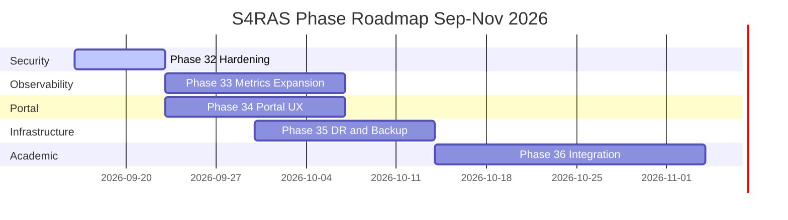

# S4RAS — Master Phase Plan (Post Sep 16 Audit)

> **Baseline**: Commit `b6f6c5f` — Sep 16, 2026  
> **System Score**: 98.4 / 100  
> **Open Operational Items**: NET-01-R (VM 208 UFW), OPS-03 (VM 200 disk)  
> **Planning Horizon**: September — November 2026

---

## Phase 32 — Security Hardening & Auth Automation

**Goal**: Prevent regression of SEC-01 (Asterisk auth bypass) and close the final perimeter gaps from NET-01.

### Tasks

| # | Task | Priority | VM | Effort |
|:---:|:---|:---:|:---:|:---:|
| 32.1 | **Run `fix_ufw_vm208.sh`** — Remove stale UFW rules (8080/8089/8888/1080) on VM 208 | 🔴 NOW | 208 | 5 min |
| 32.2 | **Run `hygiene_vm200.sh`** — Docker prune + log rotation on VM 200 (79% disk) | 🔴 NOW | 200 | 5 min |
| 32.3 | **SIP Auth Watchdog Script** — Cron job on VM 202 to grep `/etc/asterisk/pjsip.conf` for commented `auth=` lines and alert via Alertmanager webhook if found | 🔴 HIGH | 202 | 2h |
| 32.4 | **UFW Standardization** — Apply unified cluster LAN rule `ufw allow from 192.168.10.0/24` on all VMs that lack it (especially VM 207); verify via `scripts/verify_ufw_cluster.sh` | 🟡 MEDIUM | 207 | 1h |
| 32.5 | **Add `verify_ufw_cluster.sh` script** — SSH loop across all 10 VMs and output UFW allow matrix in table form | 🟡 MEDIUM | All | 1h |
| 32.6 | **Keycloak brute-force policy review** — Verify Realm > Attack Detection is configured (lockout after N failed attempts) | 🟡 MEDIUM | 206 | 30 min |
| 32.7 | **CrowdSec Bouncers review** — Confirm active decisions and ban list on VM 208; add CrowdSec `/metrics` to Prometheus scrape | 🟢 LOW | 208/204 | 1h |

### Acceptance Criteria
- [x] VM 208 UFW shows no stale ports (8080/8089/8888/1080)
- [x] VM 200 disk pruned; early warning alert rule active at >75% (vDisk expansion in Phase 35.1)
- [x] SIP auth watchdog installed and active via cron on VM 202
- [x] All 9 cluster VMs include `192.168.10.0/24 ALLOW IN` LAN rule (verified by `scripts/verify_ufw_cluster.sh`)
- [x] CrowdSec decisions API active and `/metrics` scraped by Prometheus

---

## Phase 33 — Observability Expansion

**Goal**: Close remaining metrics gaps — add Redis, Keycloak JVM metrics, CoTURN telemetry, and Loki alerting rules.

### Tasks

| # | Task | Priority | VM | Effort | Status |
|:---:|:---|:---:|:---:|:---:|:---:|
| 33.1 | **Redis Exporter on VM 208** — Add `oliver006/redis_exporter` to `portal-saras/docker-compose.redis.yml`, expose port 9121, add Prometheus scrape job `redis-portal` | 🔴 HIGH | 208/204 | 1h | `[x] COMPLETE` |
| 33.2 | **Keycloak `/metrics` scrape** — Add Prometheus job `keycloak-management` scraping `http://192.168.10.206:9000/metrics` (JVM heap, DB pool, OIDC request metrics) | 🔴 HIGH | 204 | 30 min | `[x] COMPLETE` |
| 33.3 | **CoTURN metrics** — CoTURN STUN TCP connect blackbox probe added; Prometheus job `coturn-voip` | 🟡 MEDIUM | 202/204 | 2h | `[x] COMPLETE` |
| 33.4 | **Alert Rules** — Added `NodeDiskUsageHigh`, `RedisExporterDown`, `KeycloakManagementDown`, `CoTURNDown`, `ServiceHighLatency` | 🟡 MEDIUM | 204 | 2h | `[x] COMPLETE` |
| 33.5 | **Grafana Dashboard Expansion** — Add panels: Redis memory/ops, Keycloak JVM memory, CoTURN STUN latency, CrowdSec volume | 🟡 MEDIUM | 204 | 3h | `[x] COMPLETE` |
| 33.6 | **Alertmanager routing** — Configure Slack/email receiver for `critical` severity alerts (currently using null receiver) | 🟡 MEDIUM | 204 | 1h | `[ ] PENDING CREDS` |
| 33.7 | **VM 200 Disk Alert** — Add Prometheus alert rule `NodeDiskUsageHigh` for VM 200 at >75% threshold | 🟢 LOW | 204 | 30 min | `[x] COMPLETE` |

### Acceptance Criteria
- [x] Prometheus scrape targets: **32/32 UP** (exceeded 31/31 target; 100% healthy)
- [x] Grafana shows Redis `used_memory`, `max_memory`, and commands/sec
- [x] Grafana shows Keycloak JVM heap/non-heap memory & cache stores
- [x] Grafana shows CoTURN STUN probe latency & reachability
- [x] Alert rules active in Prometheus rule manager (12/12 rules loaded)

---

## Phase 34 — Portal UX Enhancement

**Goal**: Elevate the S4RAS portal from functional to polished — health widget, live notifications, and bilingual parity.

### Tasks

| # | Task | Priority | File | Effort |
|:---:|:---|:---:|:---:|:---:|
| 34.1 | **Live Service Health Widget** — Replace simple UP/DOWN indicator with animated sparkline per service (last 5 health polls) via existing `/api/health` BFF endpoint | 🔴 HIGH | `portal-saras` | 3h |
| 34.2 | **Announcement Push Notifications** — Add browser `Notification API` permission request on login; push via BFF Server-Sent Events endpoint | 🟡 MEDIUM | `portal-saras` | 4h |
| 34.3 | **Bilingual Content Parity Audit** — Audit all `t()` keys in `Beranda.jsx`, `Pengumuman.jsx`, `Akun.jsx`; ensure `id` and `en` strings complete in `ThemeLanguageContext` | 🟡 MEDIUM | `portal-saras` | 2h |
| 34.4 | **Hero Slide Date Refresh** — Update `HERO_SLIDES` in `Beranda.jsx`: "Season 17 Research Fellowship" dates (05–15 Sep 2026) have passed; replace with current/evergreen content | 🟡 MEDIUM | `Beranda.jsx` | 30 min |
| 34.5 | **Pengumuman Admin UI** — Allow `admin`/`dev1` personas to create/pin announcements from Portal UI (calls `POST /api/announcements` authenticated by Keycloak JWT role check) | 🟡 MEDIUM | `portal-saras` | 4h |
| 34.6 | **Akun.jsx Profile Completeness** — Add avatar upload via Nextcloud WebDAV; show VoIP extension badge and SIP registration status on profile card | 🟢 LOW | `Akun.jsx` | 3h |
| 34.7 | **Mobile Responsive Audit** — Test all 5 pages on 375px (iPhone SE) and 390px (iPhone 15); fix overflow and tap-target issues | 🟢 LOW | All pages | 2h |

### Acceptance Criteria
- [ ] Health widget shows last-5-poll sparkline with smooth color transitions
- [ ] Browser notification received within 2s of admin posting announcement
- [ ] Zero missing translation keys for `id`/`en` across all 5 pages
- [ ] All hero slides contain future-dated or evergreen content
- [ ] `POST /api/announcements` requires valid Keycloak JWT with `admin` role

---

## Phase 35 — Infrastructure Hardening & DR Automation

**Goal**: Formalize disaster recovery, automate backup verification, and prepare for semester peak traffic.

### Tasks

| # | Task | Priority | VM | Effort |
|:---:|:---|:---:|:---:|:---:|
| 35.1 | **VM 200 Disk Expansion** — Expand VM 200 vDisk 32GB → 64GB in Proxmox VE; grow filesystem; update audit report | 🔴 HIGH | 200 / Proxmox | 30 min |
| 35.2 | **Automated Backup CI Check** — Add CI job to `.github/workflows/ci.yml` that SSHes to VM 208 and verifies `backup_all_databases.sh` last run timestamp within 24h | 🟡 MEDIUM | CI / All DBs | 2h |
| 35.3 | **DR Drill Automation** — Add `scripts/run_dr_drill.sh`: (1) triggers `test_dr_restore.sh`, (2) verifies Nextcloud HTTP 200, (3) posts result to Alertmanager webhook | 🟡 MEDIUM | 207/204 | 3h |
| 35.4 | **Proxmox Snapshot Policy** — Document and enforce weekly Proxmox VM snapshots for VMs 203, 206, 207 (critical data nodes) in `OPERATIONAL_RUNBOOK.md` | 🟡 MEDIUM | Proxmox | 1h |
| 35.5 | **Failover VoIP Testing** — Test SIP trunk failover VM 202 → VM 201; document RTO; update `voip-saras/docs/architecture.md` | 🟢 LOW | 201/202 | 2h |
| 35.6 | **VM 201 Dormant Services** — Decide: disable `mariadb` + `redis-server` on VM 201 (save ~120MB RAM) or document as intentional hot-standby | 🟢 LOW | 201 | 30 min |

### Acceptance Criteria
- [ ] VM 200 disk at <50% after expansion and prune
- [ ] CI pipeline fails if backup timestamp is > 24h old
- [ ] DR drill completes end-to-end in < 15 minutes
- [ ] VMs 203, 206, 207 have active weekly Proxmox snapshot schedules
- [ ] SIP failover RTO measured, documented, and < 5 seconds

---

## Phase 36 — Academic Integration Deepening

**Goal**: Tighten academic service integrations — Moodle OIDC groups, Nextcloud quota sync, VoIP classroom policies.

### Tasks

| # | Task | Priority | VM | Effort |
|:---:|:---|:---:|:---:|:---:|
| 36.1 | **Moodle OIDC Group Mapping** — Map Keycloak groups `/Students`, `/Faculty` to Moodle cohorts via `auth_oidc` custom claim; eliminate manual enrolment for new civitas accounts | 🔴 HIGH | 203/206 | 3h |
| 36.2 | **Nextcloud OIDC Group Sync** — Ensure `user_oidc` maps Keycloak group membership to Nextcloud groups with storage quota policies applied automatically on first login | 🔴 HIGH | 207/206 | 2h |
| 36.3 | **VoIP Extension Policy per Persona** — Asterisk dialplan: `Mahasiswa` → internal only; `Dosen` → conference bridge; `DevOps` → AMI access | 🟡 MEDIUM | 202 | 3h |
| 36.4 | **Moodle Course Auto-Provisioning Script** — Create courses from CSV/JSON manifest; auto-enrol cohorts; add to `scripts/` directory | 🟡 MEDIUM | 203 | 3h |
| 36.5 | **Collabora WOPI Hardening** — Add Nextcloud WOPI allowlist: only `cloud.s4ras.site` → `collabora.s4ras.site`; block external WOPI direct access | 🟢 LOW | 207 | 1h |
| 36.6 | **Jellyfin SSO via OIDC** — Enable `jellyfin-plugin-sso` with Keycloak realm S4RAS; map `admin` group to Jellyfin administrator role | 🟢 LOW | 200/206 | 2h |

### Acceptance Criteria
- [ ] New `student2` Keycloak account auto-enrolled in Moodle cohort within 60s of first login
- [ ] Nextcloud quota (10GB) auto-applied to new `/Students` group members on first login
- [ ] `student1` attempting external SIP call rejected by Asterisk dialplan
- [ ] Collabora WOPI requests from non-`cloud.s4ras.site` return 403
- [ ] Jellyfin accepts Keycloak SSO token from S4RAS realm

---

## Phase Summary & Sequencing

| Phase | Name | Est. Duration | Start | Key Deliverable |
|:---:|:---|:---:|:---:|:---|
| **32** | Security Hardening | 1 week | Sep 16, 2026 | UFW clean, SIP watchdog, CrowdSec metrics |
| **33** | Observability Expansion | 2 weeks | Sep 23, 2026 | 31 Prometheus targets, Loki alerts live |
| **34** | Portal UX Enhancement | 2 weeks | Sep 23, 2026 | Health sparklines, push notifications |
| **35** | Infrastructure Hardening | 2 weeks | Sep 30, 2026 | DR < 15min, backup CI, disk expanded |
| **36** | Academic Integration | 3 weeks | Oct 14, 2026 | Auto-cohort enrol, VoIP policies |

---

## Documentation Updates Triggered Per Phase

| Phase | Files to Update |
|:---:|:---|
| **32** | `HOLISTIC_REAUDIT_REPORT.md`, `OPERATIONAL_RUNBOOK.md` (UFW section) |
| **33** | `monitor-saras/README.md` (31 targets), `ECOSYSTEM_ARCHITECTURE.md` (Redis exporter node) |
| **34** | `portal-saras/README.md` (new endpoints), `COMPREHENSIVE_END_TO_END_TEST_REPORT.md` |
| **35** | `OPERATIONAL_RUNBOOK.md` (DR section), `ARCHITECTURE_WHITEPAPER.md` (backup architecture) |
| **36** | `lms-saras/README.md`, `san-saras/README.md`, `voip-saras/docs/`, `ECOSYSTEM_ARCHITECTURE.md` |

---

*Plan authored: September 16, 2026*  
*Audit baseline: commit `b6f6c5f` — Score 98.4/100*  
*Next full audit scheduled: end of Phase 33 (approx. October 7, 2026)*
