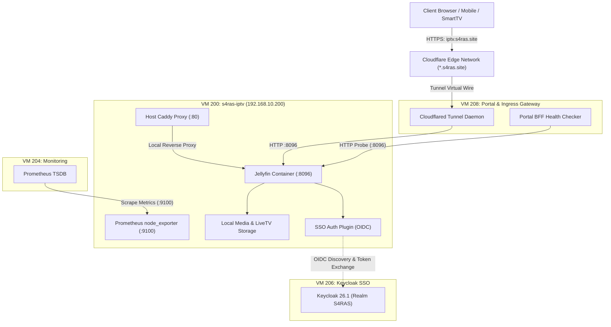
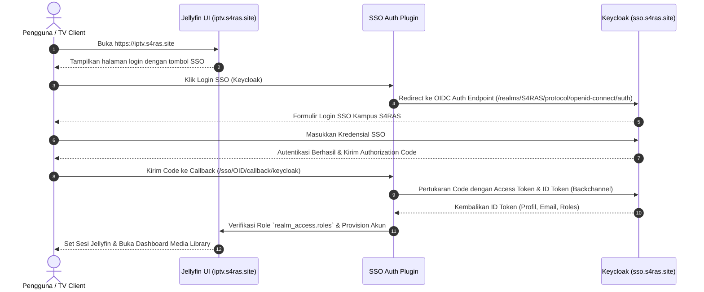

# Arsitektur Sistem IPTV S4RAS (Jellyfin Media Server)

Dokumen ini menjelaskan rancangan arsitektur, topologi jaringan, boundary keamanan, dan interaksi komponen pada layanan IPTV/Media Server di ekosistem S4RAS.

---

## 1. Topologi Komponen & Jaringan

Layanan IPTV dijalankan pada VM 200 (`s4ras-iptv`) di dalam subnet privat RFC1918 `192.168.10.0/24`. Layanan ini terisolasi dari paparan port publik langsung (NAT terhindar) dan diakses secara aman melalui Cloudflare Tunnel ingress daemon di VM 208.

---

## 2. Rincian Komponen Arsitektur

### A. Media Server Container (`jellyfin`)
* **Base Image**: `jellyfin/jellyfin:latest` (Official .NET-based media engine).
* **Eksekusi Host**: Berjalan di Docker Engine v27 dengan mode network `bridge` dan port forwarding `8096:8096`.
* **Resource Mounts**:
  * `/home/s4ras/jellyfin/config` dipetakan ke `/config` (database SQLite, metadata cache, XML server configuration, plugin binaries).
  * `/home/s4ras/jellyfin/cache` dipetakan ke `/cache` (transcoding cache, trickplay thumbnails).
  * `/home/s4ras/jellyfin/media` dipetakan ke `/media` (library konten direktori anime, movies, tvshows).

### B. Ingress & Edge Routing
* Cloudflare Tunnel pada VM 208 mengarahkan hostname `iptv.s4ras.site` langsung ke socket HTTP internal `http://192.168.10.200:8096`.
* Host Caddy di VM 200 bertindak sebagai proxy cadangan di port 80 untuk lalu lintas intra-LAN, meneruskan request internal langsung ke port 8096.

### C. Modul Keamanan dan SSO
* **Plugin**: `jellyfin-plugin-sso` (SSO Authentication v4.0.0.4).
* **Integrasi OIDC**: Menggunakan protokol OpenID Connect ke Keycloak server (`https://sso.s4ras.site/realms/S4RAS`) dengan Client ID `jellyfin`.
* **Enkapsulasi Klien**: Mengisolasi otentikasi kata sandi dari database lokal Jellyfin ke federasi identitas kampus S4RAS.

---

## 3. Diagram Alur Autentikasi Pengguna (SSO Flow)

