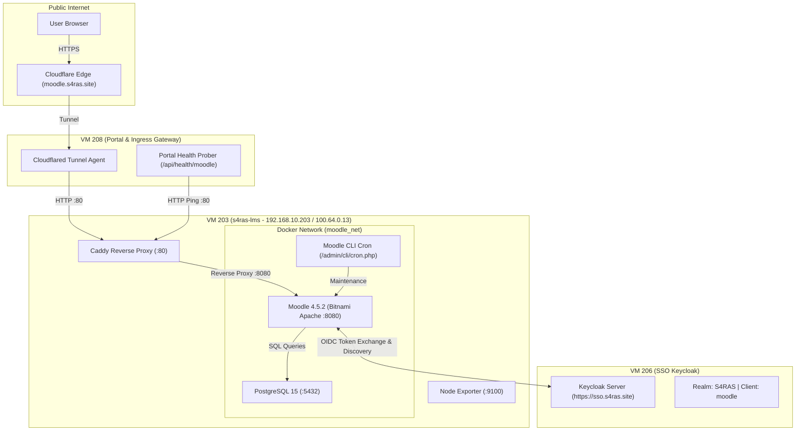

# S4RAS LMS Service (Moodle)

Repositori ini memuat konfigurasi, arsitektur, dan panduan operasional untuk layanan **Learning Management System (LMS) Moodle** pada ekosistem S4RAS. Layanan ini di-host pada Virtual Machine Proxmox ID **203** (`s4ras-lms`).

---

##  Ringkasan Layanan

* **Platform LMS**: [Moodle 4.5.2](https://moodle.org/) (Bitnami Docker Containerized)
* **Database Backend**: PostgreSQL 15 (Containerized)
* **Web Server & Reverse Proxy**: Caddy 2.x (Host Level) + Bitnami Apache (Container Level)
* **Single Sign-On (SSO)**: Keycloak OIDC via plugin `auth_oidc`
* **Health Prober**: Terintegrasi pada Portal S4RAS (`https://portal.s4ras.site/api/health/moodle`)
* **Status**: **ONLINE & OPERATIONAL** (HTTP 200 via Ingress, 3ms LAN latency)

---

##  Matriks Akses & Endpoint

| Komponen | Endpoint / Alamat | Keterangan |
| :--- | :--- | :--- |
| **URL Publik** | `https://moodle.s4ras.site` | Cloudflare Tunnel Ingress (SSL Edge) |
| **Login Moodle** | `https://moodle.s4ras.site/login/index.php` | Mendukung OIDC Keycloak & Akun Manual |
| **URL Internal Host** | `http://192.168.10.203:80` | Caddy Reverse Proxy (Host Port 80) |
| **Moodle Apache** | `http://192.168.10.203:8080` | Bitnami Apache Moodle Container |
| **Database Host** | `postgres:5432` / `172.18.0.2:5432` | PostgreSQL 15 (`moodledb`, user `moodleuser`) |
| **Tailscale IP** | `100.64.0.13` | Hostname: `s4ras-lms` |
| **SSH Direct (LAN)** | `s4ras@192.168.10.203` | Port 22 (Pass: `[REDACTED]`) |
| **SSH Tailscale** | `ssh s4ras@100.64.0.13` | Tailscale SSH aktif (zero-friction) |
| **Metrics** | `http://192.168.10.203:9100/metrics` | Node Exporter (Prometheus) |

---

##  Topologi Aliran Data (Architecture Flow)



---

##  Integrasi Keycloak Single Sign-On (SSO)

Moodle terintegrasi secara native dengan Keycloak SSO S4RAS menggunakan OpenID Connect:

* **Realm**: `S4RAS`
* **Client ID**: `moodle`
* **Access Type**: `confidential`
* **Client Secret**: `Jo4GYepxc06DvHexY88E6uHQu4cnWizs`
* **Endpoints**:
  * Authorization: `https://sso.s4ras.site/realms/S4RAS/protocol/openid-connect/auth`
  * Token: `https://sso.s4ras.site/realms/S4RAS/protocol/openid-connect/token`
  * UserInfo: `https://sso.s4ras.site/realms/S4RAS/protocol/openid-connect/userinfo`
  * Logout: `https://sso.s4ras.site/realms/S4RAS/protocol/openid-connect/logout`
* **Valid Redirect URIs**: `https://moodle.s4ras.site/auth/oidc/*`
* **Username Claim**: `email`

---

##  Struktur Repositori

```
lms-saras/
├── README.md                              # Dokumentasi utama LMS Moodle
├── docker-compose.yml                     # Konfigurasi container Moodle & PostgreSQL
├── config/
│   ├── Caddyfile                          # Reverse proxy host level Caddy
│   ├── config.php.template                # Konfigurasi PHP Moodle wwwroot & proxy
│   └── netplan-ens18.yaml                 # Konfigurasi static IP Netplan clean
└── docs/
    ├── architecture.md                    # Desain arsitektur detail & container specs
    ├── configuration_and_sso.md           # Konfigurasi Keycloak SSO & plugin auth_oidc
    └── operations_runbook.md              # SOP operasional, backup, cron, dan maintenance
```

---

##  Perintah Cepat Operasional

### 1. Manajemen Layanan Docker
```bash
# Masuk ke direktori Moodle pada VM 203
cd /opt/moodle

# Cek status container
docker compose ps

# Restart container
docker compose restart

# Melihat log real-time
docker compose logs -f moodle
```

### 2. Caddy Reverse Proxy
```bash
# Cek status Caddy
sudo systemctl status caddy

# Reload konfigurasi Caddy
sudo systemctl reload caddy
```

### 3. Pembersihan Cache Moodle
```bash
docker exec -u 0 moodle php /opt/bitnami/moodle/admin/cli/purge_caches.php
```


---

## ⚡ Mitigasi Bottleneck CPU (Hasil Evaluasi Uji Beban 50 User)

Berdasarkan pengujian beban 50 user serentak pada dokumen penelitian S4RAS, pemanfaatan CPU VM LMS menyentuh ~100% dengan penurunan skor APDEX ke 0.5–0.69. Tiga langkah mitigasi teknis yang telah diterapkan:

1. **Redis Session Driver**: Mengalihkan penyimpanan sesi Moodle dari PostgreSQL/disk ke Redis in-memory cache (\core\session\redis) untuk menghilangkan konkurensi write-lock database.
2. **PHP OPcache Tuning**: Konfigurasi opcache.memory_consumption=256, opcache.max_accelerated_files=20000, dan opcache.validate_timestamps=0 di container Moodle.
3. **Rekomendasi vCPU Proxmox**: Meningkatkan alokasi core dari 2 vCPU ke 4 vCPU pada node VM 203 sebelum pelaksanaan ujian sekolah serentak atau kelas skala besar (>50 siswa).
