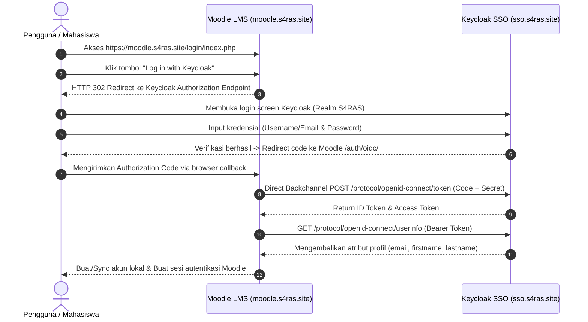

# S4RAS LMS Single Sign-On (SSO) & Keycloak Configuration

Dokumen ini memuat detail teknis integrasi **Keycloak OpenID Connect (OIDC)** pada layanan **Moodle LMS** di lingkungan S4RAS.

---

## 1. Arsitektur Autentikasi Terpusat

Moodle menggunakan plugin native **`auth_oidc`** (OpenID Connect) untuk mendelegasikan autentikasi akun kepada Keycloak Identity Provider yang berjalan di VM 206 (`https://sso.s4ras.site`).



---

## 2. Konfigurasi Keycloak (Identity Provider Side)

Pada Keycloak master console (`https://sso.s4ras.site/admin/`), client dikonfigurasikan di dalam Realm **`S4RAS`**.

### 2.1. Client Settings

* **Realm**: `S4RAS`
* **Client ID**: `moodle`
* **Name**: `Moodle LMS S4RAS`
* **Client Protocol**: `openid-connect`
* **Access Type / Client Authentication**: `Confidential` (ON)
* **Standard Flow Enabled**: `ON` (Authorization Code Flow)
* **Direct Access Grants Enabled**: `OFF`
* **Root URL**: `https://moodle.s4ras.site`
* **Home URL**: `https://moodle.s4ras.site/`
* **Valid Redirect URIs**:
  * `https://moodle.s4ras.site/auth/oidc/*`
  * `https://moodle.s4ras.site/auth/oidc/`
* **Valid Post Logout Redirect URIs**:
  * `https://moodle.s4ras.site/*`
* **Web Origins**: `+` (Mengizinkan seluruh redirect URI yang valid)

### 2.2. Credentials
* **Client Authenticator**: `Client Id and Secret`
* **Secret**: `Jo4GYepxc06DvHexY88E6uHQu4cnWizs`

---

## 3. Konfigurasi Plugin Moodle (`auth_oidc`)

Konfigurasi disimpan pada tabel database PostgreSQL `mdl_config_plugins` di bawah plugin `auth_oidc`.

| Parameter | Nilai Konfigurasi | Deskripsi |
| :--- | :--- | :--- |
| `idptype` | `3` | Custom OpenID Connect IdP (Keycloak) |
| `clientid` | `moodle` | Identitas Client ID pada Keycloak |
| `clientsecret` | `Jo4GYepxc06DvHexY88E6uHQu4cnWizs` | Kredensial rahasia client untuk token exchange |
| `clientauthmethod` | `1` | `client_secret_post` / HTTP Basic |
| `oidcscope` | `openid profile email` | Scope OIDC yang diminta saat autentikasi |
| `authendpoint` | `https://sso.s4ras.site/realms/S4RAS/protocol/openid-connect/auth` | Endpoint form login Keycloak |
| `tokenendpoint` | `https://sso.s4ras.site/realms/S4RAS/protocol/openid-connect/token` | Endpoint pertukaran authorization code |
| `oidcresource` | `https://sso.s4ras.site/realms/S4RAS/protocol/openid-connect/userinfo` | Endpoint pengambilan klaim profil |
| `logouturi` | `https://sso.s4ras.site/realms/S4RAS/protocol/openid-connect/logout` | Endpoint Single Sign-Off Keycloak |
| `bindingusernameclaim` | `email` | Menghubungkan akun Moodle berdasarkan email |
| `field_map_email` | `mail` | Mapping atribut email dari payload userinfo |
| `opname` | `Keycloak` | Label yang ditampilkan pada tombol login Moodle |
| `single_sign_off` | `1` | Mengaktifkan logout terintegrasi |
| `debugmode` | `1` | Logging detail untuk audit integrasi |

---

## 4. Pemetaan Atribut & Sinkronisasi Profil (Field Mapping)

Saat user berhasil login via Keycloak untuk pertama kalinya, akun Moodle akan dibuat secara otomatis (*Just-In-Time Provisioning*) dengan mapping atribut berikut:

* **Username**: Diambil dari claim `email` pengguna di Keycloak.
* **Email**: Diambil dari claim `email` atau `mail`.
* **Nama Depan**: Diambil dari claim `given_name`.
* **Nama Belakang**: Diambil dari claim `family_name`.
* **Auth Method**: Di-set otomatis ke `oidc` (mencegah bypass password manual).

### Status Akun Terdaftar
Berdasarkan query database terkini (`mdl_user`), akun-akun berikut telah berhasil tertaut dengan Single Sign-On:
* `admin@portal.saras.id` (Admin S4RAS)
* `civitas@s4ras.site` (Sivitas Akademika / hartono rafli)
* `rafi.rabbani12@gmail.com` (Sivitas Peneliti)
* `bagus.puntodewo@gmail.com` / `baguspunto02@gmail.com` (Bagus Puntodewo)
* `riokristian71@gmail.com` (Glorio Davis)
* `sayyidas1234@gmail.com` (Argahy Siddiq)
* `naufal.rizky7@gmail.com` (Naufal Rizqi)
* `dhikawahyuarfianputra@gmail.com` (Dhika Wahyu Arfian Putra)
* `5022211063@student.its.ac.id` (Nabil Fikri)

---

## 5. Prosedur Uji & Troubleshooting OIDC

### 5.1. Memeriksa Konektivitas dari Container Moodle ke Keycloak
Pastikan container Moodle dapat membaca endpoint `.well-known` Keycloak:
```bash
docker exec moodle curl -sI https://sso.s4ras.site/realms/S4RAS/.well-known/openid-configuration
```
*Hasil yang diharapkan*: `HTTP/2 200 OK` dengan metadata JSON OIDC.

### 5.2. Kendala: Invalid Redirect URI
Jika browser menampilkan pesan error:
```
Invalid parameter: redirect_uri
```
* **Penyebab**: Redirect URI yang dikirim oleh Moodle tidak terdaftar pada Keycloak.
* **Solusi**: Pastikan pada Keycloak Client `moodle`, kolom **Valid Redirect URIs** memuat baris:
  ```
  https://moodle.s4ras.site/auth/oidc/*
  ```

### 5.3. Kendala: Token Exchange Fails / cURL Error 28
* **Penyebab**: Container Moodle tidak dapat mencapai `sso.s4ras.site` via HTTPS karena kendala DNS atau firewall.
* **Solusi**: Uji konektivitas `docker exec moodle curl -v https://sso.s4ras.site` dan pastikan resolver container merujuk ke DNS yang valid (`8.8.8.8`).
