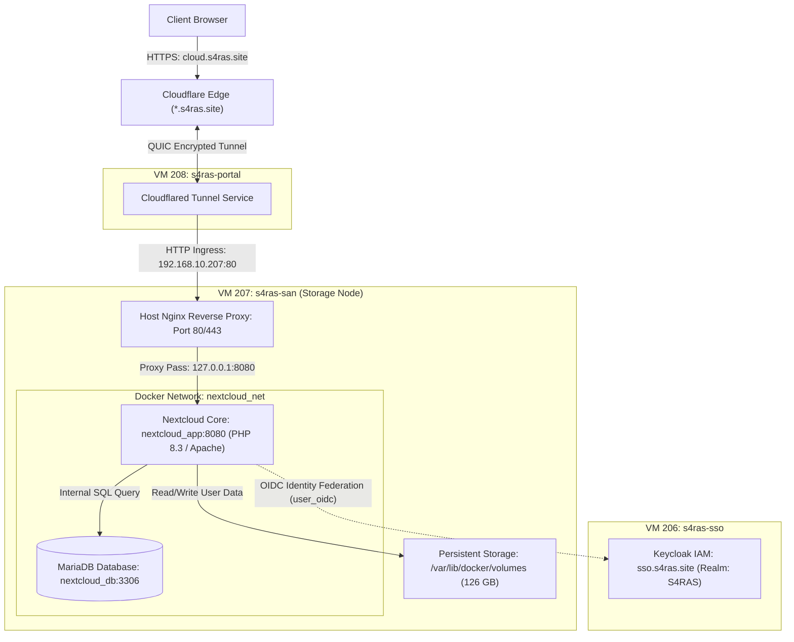

# Nextcloud SAN — S4RAS Private Storage Cloud (VM 207)

Repositori ini memuat dokumentasi teknis mendalam, spesifikasi infrastruktur, konfigurasi kontainer Docker, arsitektur integrasi SSO Keycloak, dan panduan operasional untuk **Nextcloud SAN** (`s4ras-san`) pada ekosistem S4RAS.

---

## 1. Ringkasan Sistem & Infrastruktur

| Parameter | Spesifikasi Operasional | Keterangan |
|:---|:---|:---|
| **Hostname VM** | `s4ras-san` | Proxmox VE Node `its` (VM ID: **207**) |
| **Sistem Operasi** | Ubuntu 24.04.3 LTS (Noble Numbat) | Linux Kernel 6.8.0-55-generic |
| **IP Internal (LAN)** | `192.168.10.207` | Subnet inti RFC1918 S4RAS |
| **IP Tailscale Mesh** | `100.64.0.17` | Akses manajemen terenkripsi WireGuard (`tailscale ssh`) |
| **URL Publik Ingress** | `https://cloud.s4ras.site` | Cloudflare Edge -> Cloudflared Tunnel (VM 208) |
| **URL Internal Web** | `http://192.168.10.207` | Nginx Host Reverse Proxy (Port 80/443) |
| **Container Engine** | Docker 27.5.1 / Docker Compose v2.39.1 | Stack aktif di `/opt/nextcloud` |
| **App Stack** | Nextcloud Hub 9 (v31.0.4) | Runtime: Apache 2.4 + PHP 8.3 |
| **Database Engine** | MariaDB 11.4 | Container `nextcloud_db` (Port 3306) |
| **Observability** | Prometheus `node_exporter` v1.7.0 | Port `9100` (Scraped oleh VM 204) |

---

## 2. Alur Arsitektur Tingkat Tinggi



---

## 3. Matriks Port dan Layanan

| Port | Protokol | Layanan | Deskripsi |
|:---:|:---:|:---|:---|
| **`80`** | TCP/HTTP | Nginx Host | Reverse proxy lokal; menerima trafik dari Cloudflare Tunnel & LAN probe |
| **`443`** | TCP/HTTPS | Nginx Host | SSL internal / HSTS terminator (jika diakses via IP LAN) |
| **`8080`** | TCP/HTTP | Docker `nextcloud_app` | Port binding aplikasi Nextcloud dari kontainer ke host |
| **`3306`** | TCP/MySQL | Docker `nextcloud_db` | Port database MariaDB internal (`nextcloud_net`) |
| **`9100`** | TCP/HTTP | Prometheus `node_exporter` | Metrik utilisasi CPU, RAM, Disk untuk dashboard Grafana |
| **`22`** | TCP/SSH | OpenSSH & Tailscale SSH | Akses terminal administratif aman |

---

## 4. Struktur Direktori Dokumentasi

Dokumentasi Nextcloud SAN dibagi menjadi beberapa spesifikasi terstruktur:

```
san-saras/
├── README.md                                # Master dokumentasi SAN & ringkasan eksekutif
├── docker-compose.yml                       # Spesifikasi kontainer Docker produksi
├── config/
│   ├── nextcloud.conf                       # Template konfigurasi Nginx reverse proxy host
│   └── config.php.template                  # Template konfigurasi Nextcloud PHP
└── docs/
    ├── architecture.md                      # Detail arsitektur teknis, C4 diagram, & topologi jaringan
    ├── configuration_and_sso.md             # Konfigurasi config.php, proxy headers, & SSO Keycloak OIDC
    ├── users_storage_and_database.md        # Struktur database MariaDB, kuota storage, & direktori user
    └── operations_runbook.md                # Panduan CLI occ, maintenance mode, backup/restore, & recovery
```

---

## 5. Perintah Cepat Operasional (Quick Reference)

### A. Manajemen Kontainer Docker
```bash
# Pindah ke direktori kerja
cd /opt/nextcloud

# Cek status kontainer
docker compose ps

# Restart stack Nextcloud
docker compose restart

# Melihat log aplikasi secara realtime
docker compose logs -f app
```

### B. Administrasi CLI Nextcloud (`occ`)
Semua perintah administratif Nextcloud dijalankan melalui kontainer `nextcloud_app` dengan user `www-data`:
```bash
# Cek status instalasi Nextcloud
docker exec -u www-data nextcloud_app php occ status

# Menyalakan / mematikan Maintenance Mode
docker exec -u www-data nextcloud_app php occ maintenance:mode --on
docker exec -u www-data nextcloud_app php occ maintenance:mode --off

# Melihat daftar user
docker exec -u www-data nextcloud_app php occ user:list

# Menambah trusted domain baru
docker exec -u www-data nextcloud_app php occ config:system:set trusted_domains 0 --value="cloud.s4ras.site"

# Cek konfigurasi OpenID Connect (Keycloak)
docker exec -u www-data nextcloud_app php occ user_oidc:provider
```

### C. Backup Database Cepat
```bash
# Dump MariaDB langsung ke host
docker exec nextcloud_db mariadb-dump -u user -pProxmox8 nextcloud > /opt/nextcloud/backup_$(date +%F).sql
```
