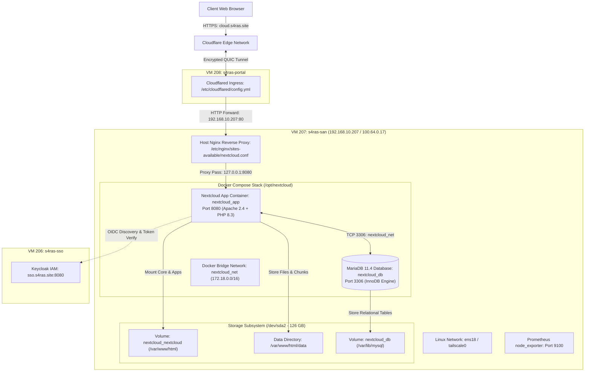

# Technical Architecture — Nextcloud SAN (VM 207)

Dokumen ini menjelaskan arsitektur teknis, topologi jaringan, ingress tunnel, struktur kontainer Docker, dan desain penyimpanan persisten untuk server **Nextcloud SAN** (`s4ras-san`).

---

## 1. Diagram Arsitektur Kontainer & Jaringan



---

## 2. Lapisan Ingress & Routing Publik

Akses publik menuju `https://cloud.s4ras.site` dirutekan melalui infrastruktur **Cloudflare Zero Trust Tunnel** yang terpasang di VM 208 (`s4ras-portal`):

1. **Edge Routing**: DNS publik `cloud.s4ras.site` berupa CNAME yang mengarah ke endpoint Cloudflare Tunnel (`78629ec0-c848-4003-a94e-1d072d1db100.cfargotunnel.com`).
2. **Tunnel Ingress Configuration**:
   Pada VM 208 (`/etc/cloudflared/config.yml`):
   ```yaml
   ingress:
     - hostname: cloud.s4ras.site
       service: http://192.168.10.207
   ```
3. **Host Nginx Demultiplexing**:
   Request tiba di interface `ens18` (`192.168.10.207:80`) VM 207. Nginx host membaca Host Header `cloud.s4ras.site` dan meneruskannya ke port lokal `http://127.0.0.1:8080` tempat kontainer Nextcloud mendengarkan.
4. **Header Normalisasi**:
   Nginx menyuntikkan header standar proxy (`X-Forwarded-For`, `X-Forwarded-Proto https`, `X-Forwarded-Host`) agar Nextcloud mengenali request sebagai HTTPS aman dan tidak menghasilkan redirect loop ke HTTP.

---

## 3. Komponen Docker & Runtime Stack

Stack dijalankan melalui Docker Compose di path `/opt/nextcloud/docker-compose.yml`:

### A. Nextcloud App Core (`nextcloud_app`)
* **Image**: `nextcloud:31.0.4-apache` (Debian-based)
* **Web Server**: Apache 2.4 dengan modul `mod_rewrite` dan `mod_headers`
* **PHP Engine**: PHP 8.3.20 (Zend Engine v4.3.20)
* **Port Mapping**: `127.0.0.1:8080 -> 80/tcp` (terikat ke loopback untuk keamanan)
* **Memcache**: APCu (`\OC\Memcache\APCu`) untuk memory caching lokal

### B. MariaDB Database (`nextcloud_db`)
* **Image**: `mariadb:11.4`
* **Storage Engine**: InnoDB dengan `READ-COMMITTED` transaction isolation dan `ROW` binlog format
* **Port Binding**: Internal kontainer saja pada port `3306` (terisolasi dalam `nextcloud_net`)
* **Database Name**: `nextcloud`
* **Database User**: `user`

### C. Host Nginx Reverse Proxy
* **Package**: `nginx/1.24.0 (Ubuntu)` berjalan secara native via systemd (`nginx.service`).
* **Fungsi**:
  * Menangani request masuk pada port 80 dan 443.
  * Meneruskan trafik ke backend kontainer Nextcloud di port 8080.
  * Menyediakan buffer upload dan websocket proxy untuk fitur kolaborasi Nextcloud Talk / text editor.

---

## 4. Arsitektur Penyimpanan & Volume Data

Penyimpanan persisten Nextcloud diatur menggunakan Docker Named Volumes yang tersimpan di disk utama VM 207:

```
/dev/sda2 (126 GB total, ~99 GB free)
└── /var/lib/docker/volumes/
    ├── nextcloud_nextcloud/_data/           # Root Nextcloud (/var/www/html)
    │   ├── config/config.php               # File konfigurasi utama
    │   ├── custom_apps/                    # Aplikasi tambahan (user_oidc, dll)
    │   └── data/                           # Data payload pengguna & admin
    │       ├── admin/files/                # File user admin
    │       ├── <user_uuid>/files/          # File user OIDC (mahasiswa/dosen)
    │       ├── appdata_ocwqd9jn35xi/       # Preview cache, thumbnails, avatars
    │       └── nextcloud.log               # Log utama aplikasi
    └── nextcloud_db/_data/                 # Data direktori database MariaDB
        ├── ibdata1, ib_logfile*
        └── nextcloud/                      # Tabel-tabel database Nextcloud
```

---

## 5. Konektivitas & Mesh Jaringan Tailscale

VM 207 terhubung ke jaringan mesh **Tailscale** S4RAS:
* **Node Name**: `s4ras-san`
* **Tailscale IP**: `100.64.0.17`
* **Fitur Aktif**:
  * **Tailscale SSH**: Memungkinkan koneksi terminal tanpa pembukaan port 22 ke publik.
  * **Mesh Routing**: VM 207 dapat langsung berkomunikasi dengan `s4ras-sso` (`100.64.0.16`), `s4ras-portal` (`100.64.0.18`), dan workstation administrator.
