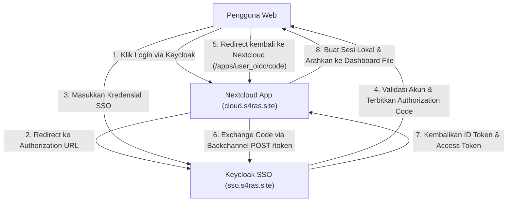

# Configuration & SSO Specification — Nextcloud SAN (VM 207)

Dokumen ini memuat detail konfigurasi sistem Nextcloud (`config.php`), konfigurasi reverse proxy host Nginx, serta spesifikasi integrasi Single Sign-On (SSO) OpenID Connect (OIDC) dengan Keycloak.

---

## 1. Spesifikasi File Konfigurasi (`config.php`)

File konfigurasi utama Nextcloud berada di:
`/var/lib/docker/volumes/nextcloud_nextcloud/_data/config/config.php`

### Parameter Kunci untuk Lingkungan Produksi S4RAS

```php
<?php
$CONFIG = array (
  // ── Identitas & Keamanan Dasar ───────────────────────────────────────────
  'instanceid'                  => 'ocwqd9jn35xi',
  'passwordsalt'                => 'zEdz15CWC69px0WecqpHPsfckrpl85',
  'secret'                      => '0OW5iiXgUE8YwE1d1wKhbZT/T4E+r/yXr194zW9vHY3bHxNM',
  'datadirectory'               => '/var/www/html/data',
  'installed'                   => true,
  'version'                     => '31.0.4.1',
  'upgrade.disable-web'         => true,

  // ── Trusted Domains ──────────────────────────────────────────────────────
  // Domain atau IP yang diizinkan mengakses Nextcloud tanpa peringatan
  'trusted_domains' => 
  array (
    0 => 'cloud.s4ras.site',
    1 => '192.168.10.207',
    2 => '100.64.0.17',
    3 => 'localhost',
    4 => '127.0.0.1',
  ),

  // ── Reverse Proxy & URL Rewriting ────────────────────────────────────────
  // Memastikan link publik, CSS/JS assets, dan redirect HTTPS di-generate dengan benar
  'overwritehost'               => 'cloud.s4ras.site',
  'overwriteprotocol'           => 'https',
  'overwrite.cli.url'           => 'https://cloud.s4ras.site',
  'htaccess.RewriteBase'        => '/',
  'trusted_proxies' => 
  array (
    0 => '127.0.0.1',
    1 => '192.168.10.208',      // IP VM Portal / Cloudflare Tunnel Ingress
    2 => '192.168.10.0/24',     // Seluruh subnet internal S4RAS
  ),
  'forwarded_for_headers'       => array('HTTP_X_FORWARDED_FOR'),

  // ── Database Backend (MariaDB) ───────────────────────────────────────────
  'dbtype'                      => 'mysql',
  'dbname'                      => 'nextcloud',
  'dbhost'                      => 'db',
  'dbport'                      => '',
  'dbtableprefix'               => 'oc_',
  'mysql.utf8mb4'               => true,
  'dbuser'                      => 'user',
  'dbpassword'                  => 'Proxmox8',

  // ── Memory Caching & Kinerja ─────────────────────────────────────────────
  'memcache.local'              => '\\OC\\Memcache\\APCu',
  'allow_local_remote_servers'  => true,
);
```

---

## 2. Integrasi Single Sign-On (SSO) dengan Keycloak

Nextcloud terhubung ke server Keycloak VM 206 (`sso.s4ras.site`) menggunakan aplikasi resmi **`user_oidc`** (OpenID Connect user backend).

### A. Parameter Integrasi Provider OIDC

| Parameter | Nilai Konfigurasi | Keterangan |
|:---|:---|:---|
| **Aplikasi Nextcloud** | `user_oidc` (v7.2.0) | Terpasang dan aktif di Nextcloud |
| **Nama Provider / ID** | `Keycloak` | Label tombol login di halaman muka |
| **Discovery Endpoint** | `https://sso.s4ras.site/realms/S4RAS/.well-known/openid-configuration` | Metadata OpenID Connect otomatis |
| **Client ID** | `nextcloud` | ID Klien yang terdaftar di Keycloak |
| **Client Secret** | *(Managed Secret di Keycloak)* | Kredensial rahasia autentikasi |
| **Scope** | `openid email profile` | Klaim identitas dasar yang diminta |
| **Unique UID** | `true` | Mencegah konflik akun lokal dan OIDC |
| **End Session Endpoint** | `https://sso.s4ras.site/realms/S4RAS/protocol/openid-connect/logout` | Single Sign-Out global |

### B. Konfigurasi Provider via CLI `occ`
Untuk mendaftarkan atau memperbarui provider Keycloak di Nextcloud:
```bash
docker exec -u www-data nextcloud_app php occ user_oidc:provider \
    --clientid="nextcloud" \
    --clientsecret="<KEYCLOAK_CLIENT_SECRET>" \
    --discoveryuri="https://sso.s4ras.site/realms/S4RAS/.well-known/openid-configuration" \
    --scope="openid email profile" \
    --unique-uid=1 \
    --send-id-token-hint=1 \
    Keycloak
```

### C. Alur Login Pengguna (Authorization Code Flow with PKCE)



---

## 3. Konfigurasi Host Nginx Reverse Proxy

Nginx host bertindak sebagai gerbang pertama yang menerima trafik port 80/443 dan meneruskannya ke kontainer Nextcloud di `127.0.0.1:8080`.

File konfigurasi di: `/etc/nginx/sites-available/nextcloud.conf`

```nginx
# ==============================================================================
# Nginx Virtual Host for Nextcloud SAN (cloud.s4ras.site)
# ==============================================================================

server {
    listen 80;
    listen [::]:80;
    server_name cloud.s4ras.site 192.168.10.207 100.64.0.17;

    # Kapasitas upload file besar (10 GB)
    client_max_body_size 10G;
    client_body_timeout 300s;
    client_header_timeout 300s;

    # Buffer & proxy timeout
    proxy_connect_timeout 90s;
    proxy_send_timeout 300s;
    proxy_read_timeout 300s;
    proxy_buffers 64 4k;

    location / {
        proxy_pass http://127.0.0.1:8080;
        proxy_set_header Host $host;
        proxy_set_header X-Real-IP $remote_addr;
        proxy_set_header X-Forwarded-For $proxy_add_x_forwarded_for;
        proxy_set_header X-Forwarded-Proto $scheme;
        proxy_set_header X-Forwarded-Host $host;
        proxy_set_header X-Forwarded-Port $server_port;

        # Websocket support untuk Nextcloud Talk dan sync realtime
        proxy_http_version 1.1;
        proxy_set_header Upgrade $http_upgrade;
        proxy_set_header Connection "upgrade";

        # Menonaktifkan proxy buffering untuk transfer data besar
        proxy_request_buffering off;
        proxy_buffering off;
    }

    # Penanganan endpoint khusus WebDAV & CardDAV/CalDAV
    location = /.well-known/carddav {
        return 301 $scheme://$host/remote.php/dav;
    }
    location = /.well-known/caldav {
        return 301 $scheme://$host/remote.php/dav;
    }
    location = /.well-known/webfinger {
        return 301 $scheme://$host/index.php/.well-known/webfinger;
    }
    location = /.well-known/nodeinfo {
        return 301 $scheme://$host/index.php/.well-known/nodeinfo;
    }
}
```

---

## 4. Parameter Kinerja PHP & Apache (Container Environment)

Untuk memastikan pengunggahan file sinkronisasi berkecepatan tinggi tanpa timeout:

| Parameter | Nilai di Kontainer | Penjelasan |
|:---|:---|:---|
| `memory_limit` | `1024M` | Alokasi RAM untuk pemrosesan file PHP |
| `upload_max_filesize` | `10G` | Batas maksimum per file upload |
| `post_max_size` | `10G` | Batas payload HTTP POST |
| `max_execution_time` | `3600` | Batas waktu kalkulasi checksum dan hashing file |
| `max_input_time` | `3600` | Batas waktu penerimaan payload stream |
| `apc.enable_cli` | `1` | Mengaktifkan caching APCu pada script background cron |
