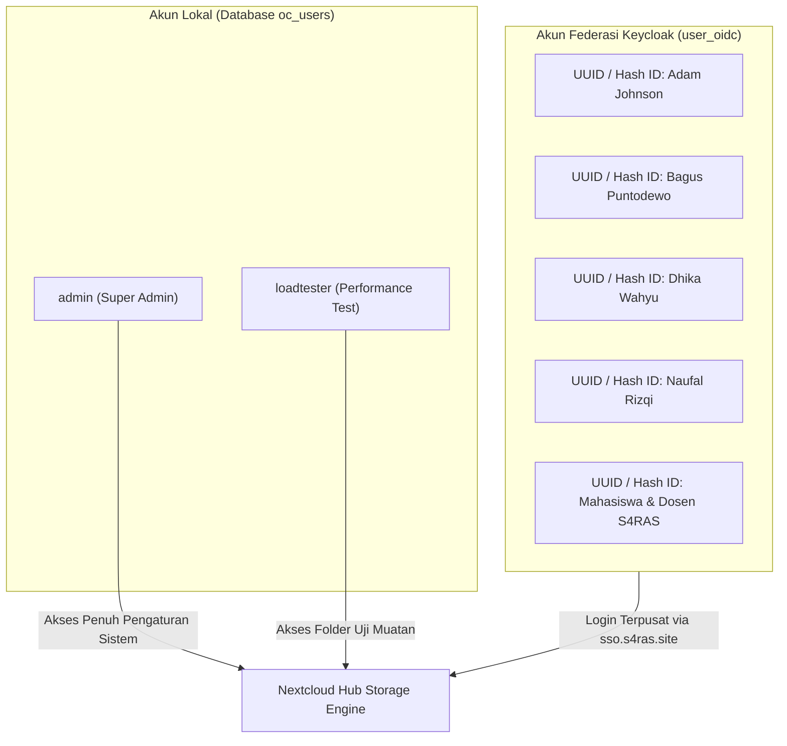

# Storage, Users & Database Specification — Nextcloud SAN (VM 207)

Dokumen ini menjelaskan struktur basis data MariaDB, skema pengguna lokal dan federasi SSO, hierarki penyimpanan file persisten, serta manajemen kuota storage pada **Nextcloud SAN** (`s4ras-san`).

---

## 1. Arsitektur Database MariaDB

Nextcloud menyimpan seluruh metadata berkas, sesi otentikasi, konfigurasi aplikasi, dan riwayat aktivitas di database **MariaDB 11.4** yang berjalan di kontainer `nextcloud_db`.

### A. Kredensial & Spesifikasi Koneksi

| Parameter | Nilai Konfigurasi | Keterangan |
|:---|:---|:---|
| **Database Host** | `db` (Port `3306`) | Resolusi DNS internal Docker network `nextcloud_net` |
| **Database Name** | `nextcloud` | Database utama aplikasi |
| **Database User** | `user` | User aplikasi non-root |
| **Database Password**| `Proxmox8` | Terdefinisi di `docker-compose.yml` dan `config.php` |
| **Root Password** | `Proxmox8` | Khusus administrasi database internal |
| **Table Prefix** | `oc_` | Prefix standar seluruh tabel Nextcloud |
| **Charset / Collation**| `utf8mb4` / `utf8mb4_bin` | Mendukung karakter multibyte dan emoji |
| **Storage Engine** | `InnoDB` | Mendukung transaksi ACID dan row-level locking |

### B. Tabel-Tabel Kunci Aplikasi

* **`oc_users`**: Menyimpan daftar akun lokal (seperti `admin`, `loadtester`).
* **`oc_user_oidc_providers`**: Konfigurasi server identitas Keycloak, endpoint discovery, dan client secret.
* **`oc_filecache`**: Indeks metadata seluruh file (path berkas, mime-type, ukuran, checksum hash, mtime).
* **`oc_storages`**: Pemetaan lokasi penyimpanan fisik ke storage ID logis.
* **`oc_groups` & `oc_group_user`**: Pengelompokan hak akses (contoh: grup `admin`).
* **`oc_activity`**: Log audit jejak aktivitas (file diubah, diunduh, dibagikan).

---

## 2. Manajemen Pengguna & Model Federasi OIDC

Nextcloud SAN menerapkan model pengguna hibrida:



### A. Akun Administratif Lokal
* **Username**: `admin`
* **Grup**: `admin`
* **Tujuan**: Akses darurat jika server SSO Keycloak offline, konfigurasi aplikasi sistem, dan audit storage.

### B. Akun Terfederasi SSO (Keycloak)
* Pengguna yang login melalui tombol **Login via Keycloak** otomatis diprovisi saat pertama kali login.
* Karena opsi `unique_uid` aktif, Nextcloud membuat identifier pengguna unik (berupa hash heksadesimal 64 karakter) untuk mencegah tabrakan nama dengan akun lokal.
* Display Name dan Email dipetakan langsung dari klaim token Keycloak.

### C. Daftar Pengguna Terdaftar Saat Ini
Dapat diperiksa menggunakan perintah:
```bash
docker exec -u www-data nextcloud_app php occ user:list
```

---

## 3. Struktur Direktori Penyimpanan Persisten

Data pengguna dan file sistem tersimpan di volume Docker `nextcloud_nextcloud`:

```
/var/lib/docker/volumes/nextcloud_nextcloud/_data/data/
├── admin/
│   ├── files/                   # File & dokumen milik akun admin
│   ├── files_trashbin/          # Tempat sampah (recycle bin) admin
│   └── files_versions/          # Riwayat versi dokumen admin
│
├── <user_oidc_hash>/           # Direktori masing-masing mahasiswa/dosen
│   ├── files/                   # Folder file pribadi
│   ├── files_trashbin/
│   └── files_versions/
│
├── appdata_ocwqd9jn35xi/       # Cache aplikasi & metadata internal
│   ├── preview/                 # Thumbnail gambar & dokumen PDF
│   ├── avatar/                  # Foto profil pengguna
│   └── css/ & js/               # Asset terkompilasi
│
├── uploads/                     # File sementara proses chunked upload
└── nextcloud.log               # Log aktivitas sistem & debug
```

---

## 4. Mekanisme Chunked Upload & Batas Kuota

### A. Chunked Upload (File Berukuran Besar)
Ketika pengguna mengunggah file ISO, video rekaman kuliah, atau arsip ZIP yang melebihi batas buffer HTTP:
1. Klien Nextcloud (Web atau Desktop Sync Client) memotong file menjadi segmen-segmen kecil (biasanya 10 MB per chunk).
2. Potongan diunggah secara bertahap ke `/var/www/html/data/uploads/<hash>/`.
3. Setelah semua chunk berhasil diterima, server menggabungkan kembali berkas secara atomik, memvalidasi SHA-256 checksum, dan memindahkannya ke `/files/`.

### B. Kebijakan Tempat Sampah & Versi
* **Retensi Trashbin**: File di `files_trashbin` secara otomatis dibersihkan jika penggunaan disk mendekati batas kuota pengguna, atau setelah melewati batas waktu standar (30 hari).
* **Versi Berkas**: Setiap kali dokumen diperbarui, versi sebelumnya disimpan di `files_versions`. Nextcloud secara otomatis memangkas riwayat versi lama jika kapasitas ruang disk menipis.

---

## 5. Kapasitas & Metrik Disk VM 207

| Parameter | Nilai | Catatan |
|:---|:---|:---|
| **Partisi Sistem** | `/dev/sda2` | Filesystem `ext4` |
| **Total Kapasitas** | **126 GB** | Disk virtual Proxmox |
| **Ruang Terpakai** | **~21 GB (18%)** | File sistem, container image, dan data |
| **Ruang Tersedia** | **~99 GB (82%)** | Kapasitas bebas untuk penyimpanan pengguna |
