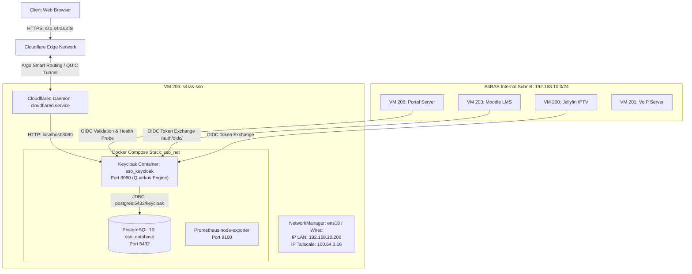

# Technical Architecture — SSO Keycloak (VM 206)

Dokumen ini menjelaskan arsitektur teknis, topologi jaringan, integrasi tunnel, dan desain kontainer dari server Single Sign-On (SSO) S4RAS.

---

## 1. Diagram Arsitektur Sistem



---

## 2. Ingress Layer: Cloudflare Tunnel (`cloudflared`)

Akses publik `https://sso.s4ras.site` tidak memerlukan pembukaan port publik (port forwarding) di router utama. Komunikasi ingress ditangani oleh **Cloudflare Tunnel**:

1. **Daemon**: Service `cloudflared.service` berjalan sebagai service systemd bawaan di VM 206:
   ```bash
   /usr/bin/cloudflared --no-autoupdate tunnel run --token <TUNNEL_TOKEN>
   ```
2. **Koneksi Keluar (Outbound-only)**: Daemon membuat koneksi TLS/QUIC keluar ke edge server Cloudflare (Singapura / `region2.v2.argotunnel.com`).
3. **Penyaluran Trafik**: Saat request menuju `sso.s4ras.site` tiba di Cloudflare, Cloudflare meneruskannya melalui tunnel terenkripsi langsung ke port `http://localhost:8080` di dalam VM 206.
4. **Header Proxy**: Keycloak dijalankan dengan opsi `--proxy-headers=xforwarded` agar mengenali protokol HTTPS dan IP asli client dari Cloudflare.

---

## 3. Komponen Kontainer Docker

Stack SSO dijalankan menggunakan Docker Compose di direktori `/home/sso/s4ras-sso`:

### A. Keycloak (`sso_keycloak`)
* **Image**: `quay.io/keycloak/keycloak:26.1`
* **Runtime**: Red Hat Quarkus Framework (Java 21)
* **Mode Start**: `start-dev --http-enabled=true --proxy-headers=xforwarded`
* **Port Terbuka**:
  * `0.0.0.0:8080` (Melayani Web UI, API Admin, dan Endpoint OIDC)
  * `9000` (Management & Metrik Kesehatan)
* **Environment Kritis**:
  * `KC_DB=postgres`
  * `KC_DB_URL=jdbc:postgresql://postgres:5432/keycloak`
  * `KC_HOSTNAME=sso.s4ras.site`
  * `KC_HTTP_ENABLED=true`
  * `KC_SPI_THEME_WELCOME_FORCE_SSL=false` (Menghindari lock admin console saat via proxy)

### B. PostgreSQL Database (`sso_database`)
* **Image**: `postgres:16`
* **Nama Database**: `keycloak`
* **User**: `keycloak`
* **Password**: `[REDACTED]`
* **Volume Persistence**: `postgres_data` (`/var/lib/docker/volumes/s4ras-sso_postgres_data/_data`)

### C. Node Exporter (`node_exporter`)
* **Image**: `prom/node-exporter:latest`
* **Fungsi**: Mengekspos metrik hardware (CPU, RAM, Disk I/O) ke VM 204 (Prometheus/Grafana).

---

## 4. Topologi Jaringan & Keamanan

### A. Alokasi Interface & IP
* **Interface Fisik**: `192.168.10.206/24` (Gateway: `192.168.10.1`, DNS: `192.168.10.1, 8.8.8.8`).
* **Interface Mesh (Tailscale)**: `100.64.0.16` (Hostname: `s4ras-sso`, SSH enabled).
* **Docker Bridge Network (`sso_net`)**: Subnet `172.20.0.0/16` yang mengisolasi database hanya agar bisa dihubungi oleh Keycloak.

### B. OIDC Security Profiles
* **PKCE (Proof Key for Code Exchange)**: Diharuskan menggunakan metode `S256` untuk klien publik (`front-end`).
* **CORS & Web Origins**: Mengizinkan `https://portal.s4ras.site` dan origin lokal (`http://localhost:3000`, `http://localhost:5173`) untuk pengembangan.
* **Token Lifetime**:
  * Access Token: 5 Menit (300 detik)
  * Refresh Token: 30 Menit (1800 detik)
  * SSO Session Max: 10 Jam (36000 detik)
