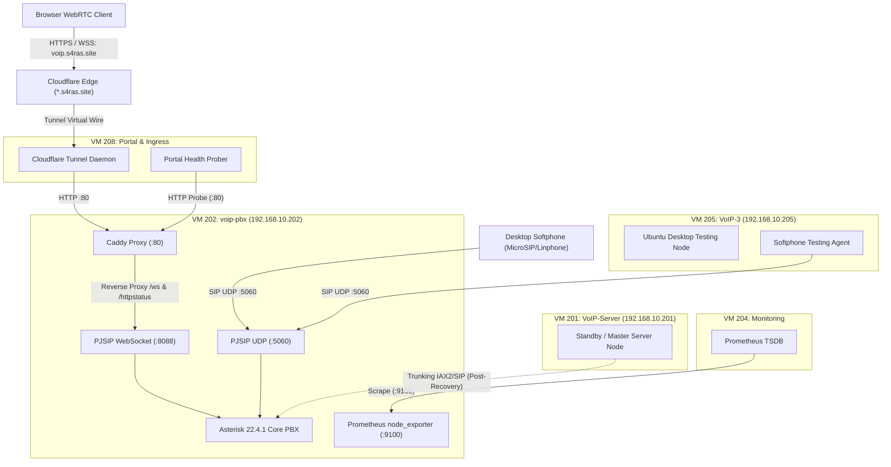
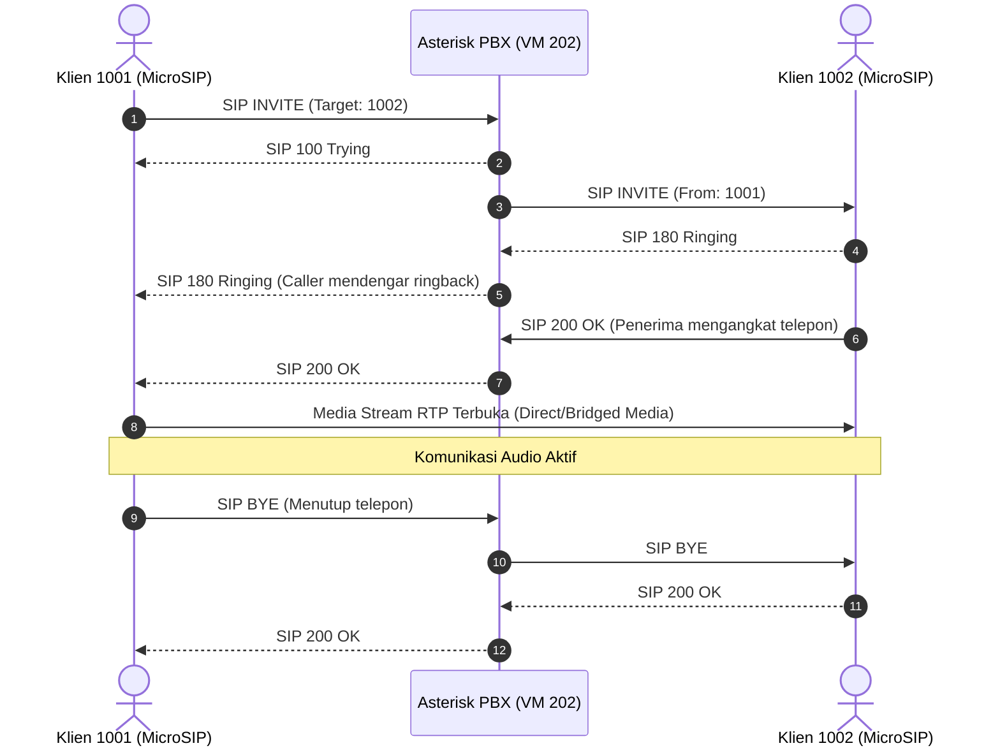

# Arsitektur Sistem VoIP S4RAS

Dokumen ini menguraikan arsitektur multi-VM layanan VoIP, topologi pensinyalan SIP, terminasi WebRTC media stream, dan integrasi ingress ekosistem S4RAS.

---

## 1. Topologi Jaringan dan Peran Simpul (Multi-VM)

Infrastruktur VoIP di S4RAS didistribusikan ke tiga virtual machine pada Proxmox VE node `its`:

---

## 2. Rincian Lapisan Protokol (Protocol Stacks)

### A. Pensinyalan SIP (Session Initiation Protocol)
* **Transport UDP**: Berjalan pada port `0.0.0.0:5060`. Menggunakan stack modern `chan_pjsip` menggantikan `chan_sip` warisan.
* **Fitur**: `rtp_symmetric=yes`, `force_rport=yes`, dan `rewrite_contact=yes` diaktifkan untuk mengatasi masalah NAT traversal pada klien yang berada di balik router atau subnet berbeda.
* **Audio Codecs**: Opus, G.722, G.711u (u-law), G.711a (a-law).

### B. WebRTC & WebSocket Transport
* **WebSocket Port**: `0.0.0.0:8088` (Plain WS secara internal, diproteksi TLS HTTPS/WSS secara publik oleh Cloudflare dan Caddy).
* **Media Encryption**: DTLS-SRTP (`media_encryption=dtls`).
* **ICE / STUN**: Mendukung `ice_support=yes` dan `use_avpf=yes` agar browser berbasis Chrome, Firefox, dan Safari dapat membuka sesi audio dua arah tanpa hambatan firewall.

### C. SIP Instant Messaging (SIP MESSAGE)
Asterisk dikonfigurasi dengan context khusus `[messages]` di `extensions.conf` yang mengolah paket SIP method `MESSAGE`, memetakan contact uri tujuan via `PJSIP_DIAL_CONTACTS()`, dan meneruskan pesan teks singkat secara real-time antar pengguna softphone.

---

## 3. Diagram Alur Panggilan Suara (Call Flow)

